# 星瀚样例金属能碳 12 页面从 0 到 1 数据填报用户手册

适用企业：星瀚样例金属科技（虚构）有限公司
租户：`demo-xinghan-metal-2025`
样例数据目录：`docs/评价方案/real_company_standardized_data/enterprises/demo-xinghan/`

## 系统接入

1. 登录平台后台。
2. 切换到「星瀚样例金属科技（虚构）有限公司」租户。
3. 按本手册顺序完成基础建档、能源数据、碳核算、产品碳足迹、供应链、辅助核查和碳资产填报。
4. 每个页面先确认当前租户和期间，再执行录入、导入、计算或导出。

## 核心任务概述

本手册采用分域填报方式，不要求把所有数据集中到一个入口。推荐顺序是：

1. 建立企业、报告主体、报告期和组织边界。
2. 导入能源、产量、Scope1、Scope2 和 Scope3 活动数据。
3. 查看能源强度、用能分析和能流图等自动分析结果。
4. 一键执行能效对标、能量平衡、碳核算、产品碳足迹和核查材料包生成。
5. 在碳资产页面维护履约周期、账户、配额、持仓、交易测算、清缴和预测。

## 页面职责与计算边界

| 步骤 | 页面 | 数据职责 | 计算方式 |
| --- | --- | --- | --- |
| 1 | `/carbon/accounting` 组织边界 | 维护报告主体、报告期、组织边界和设施范围 | 发布边界后供后续核算、核查和资产测算引用 |
| 2 | `/energy/consumption` | 导入能源事实、Scope1、Scope2、产量和产品主数据 | 导入后作为能源、碳核算和预算的底层事实 |
| 3 | `/energy/intensity` | 查看能耗强度 | 自动按能源事实和产量分母计算 |
| 4 | `/energy/analysis` | 查看结构、成本、能效、异常和策略建议 | 查询后自动刷新派生分析 |
| 5 | `/energy/flow` | 查看能流、平衡和损耗 | 查询后自动聚合能流节点、边和损耗结果 |
| 6 | `/energy/balance` | 执行能量平衡和优化测算 | 点击「执行测算」后生成结果，确认后保存记录 |
| 7 | `/energy/benchmark` | 维护或生成能效标杆 | 点击生成按钮形成对标项和整改建议 |
| 8 | `/energy/budget` | 维护年度目标和预算调整 | 月度预算、执行偏差和预警随实际数据刷新 |
| 9 | `/carbon/accounting` 排放台账 | 复核 Scope 活动数据并生成核算批次 | 点击「重建清单」生成排放台账 |
| 10 | `/carbon/product-footprint` | 维护产品研究、边界、阶段和活动清单 | 点击「计算结果」生成产品碳足迹 |
| 11 | `/carbon/supply-chain` | 维护供应商、任务、填报数据、证据和披露 | 审核、披露和统计结果基于供应链记录生成 |
| 12 | `/carbon/verification` | 维护核查项目、凭证和附件 | 点击「生成材料包」生成核查资料包 |
| 13 | `/carbon/assets` | 维护资产台账、行情、履约周期、配额、持仓和清缴 | 行情、履约缺口、交易测算和风险预测集中展示 |

`/teams` 只用于进入星瀚样例租户，不计入能碳 12 个业务页面。`/carbon/accounting` 同时承担组织边界和排放台账两类职责，因此在工作顺序中出现两次。

## 第一阶段：基础建档

### 1.1 创建或确认企业租户

路径：`/teams`

数据文件：

- `00_tenant/enterprise_profiles.csv`

操作步骤：

1. 进入团队或租户管理页面。
2. 确认存在「星瀚样例金属科技（虚构）有限公司」租户。
3. 进入该租户工作区。

系统结果：

- 后续 12 个页面均在当前租户下读取和写入数据。
- 不同企业资料包的数据不会跨租户混用。

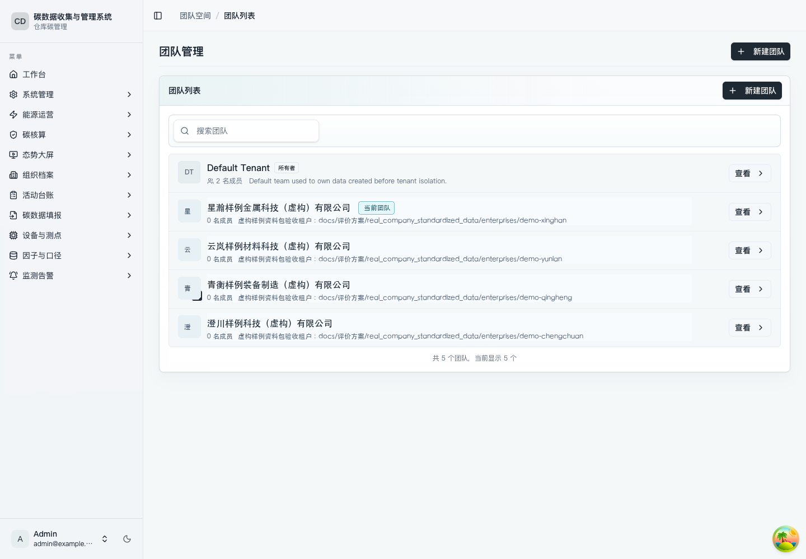

截图编号：`SHOT-DEMO-001`

### 1.2 建立报告主体、期间和组织边界

路径：`/carbon/accounting`

数据文件：

- `00_tenant/reporting_organizations.csv`
- `00_tenant/reporting_periods.csv`
- `00_tenant/organization_boundaries.csv`
- `01_carbon_accounting/reporting_organizations.csv`
- `01_carbon_accounting/reporting_periods.csv`
- `01_carbon_accounting/organization_boundaries.csv`

操作步骤：

1. 打开「碳排放核算」。
2. 切换到「组织边界」。
3. 点击「新增主体」，填写报告主体信息并保存。
4. 点击「新增报告期」，选择 2025 年报告期并保存。
5. 点击「新增边界」，维护边界版本。
6. 点击「维护设施」，补充纳入边界的设施。
7. 对边界记录点击「发布」。

系统结果：

- 发布后的组织边界会作为后续核算批次、清单重建和核查材料包的基础。
- 未发布边界不能作为正式核算依据。

截图编号：`SHOT-DEMO-002`

## 第二阶段：能源与产量数据

### 2.1 导入能源消费、Scope1、Scope2 和产量数据

路径：`/energy/consumption`

数据文件：

- `05_energy_management/energy_interval_facts.csv`
- `05_energy_management/scope1_stationary_combustion.csv`
- `05_energy_management/scope2_electricity_bills.csv`
- `05_energy_management/production_output_facts.csv`
- `05_energy_management/production_products.csv`

操作步骤：

1. 打开「能源消费」。
2. 进入「数据导入」。
3. 选择要导入的数据集。
4. 上传或粘贴对应 CSV。
5. 填写来源名称，点击「导入」。
6. 查看接收行、入库行、跳过行和错误行。
7. 如存在错误行，下载错误 CSV，修正后重新导入。

系统结果：

- 能源消费明细、能源品种统计、Scope1 固定燃烧、Scope2 电力账单和产量分母进入当前租户。
- 下游能源强度、用能分析、能流、平衡、预算和碳核算会使用这些底层数据。

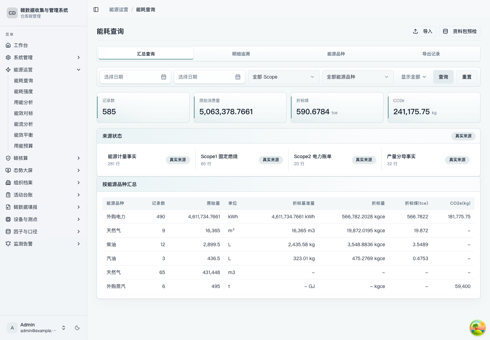

截图编号：`SHOT-DEMO-003`

### 2.2 查看能源强度计算结果

路径：`/energy/intensity`

数据文件：

- 来自 `/energy/consumption` 已导入的能源事实和产量分母。

操作步骤：

1. 打开「能源消费量和强度计算」。
2. 选择期间、产品或统计维度。
3. 点击「查询」。
4. 查看消费量汇总、面积强度、产品强度、产值强度、区域设备和趋势分析。

系统结果：

- 系统自动用能源消费量和产量分母计算强度指标。
- 用户不需要在该页重复录入底层能源明细。

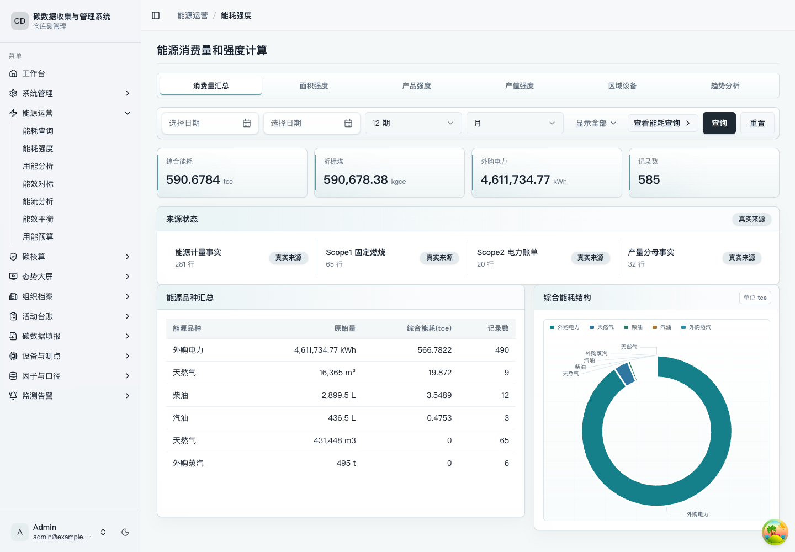

截图编号：`SHOT-DEMO-004`

### 2.3 查看用能分析

路径：`/energy/analysis`

数据文件：

- 来自 `/energy/consumption` 已导入的能源事实。

操作步骤：

1. 打开「用能分析」。
2. 选择期间和分析维度。
3. 点击「查询」。
4. 依次查看「结构分析」「成本分析」「能效分析」「异常诊断」「策略建议」。

系统结果：

- 系统自动生成趋势、结构、异常和策略建议。
- 若导入了新的能源事实，重新查询即可刷新结果。

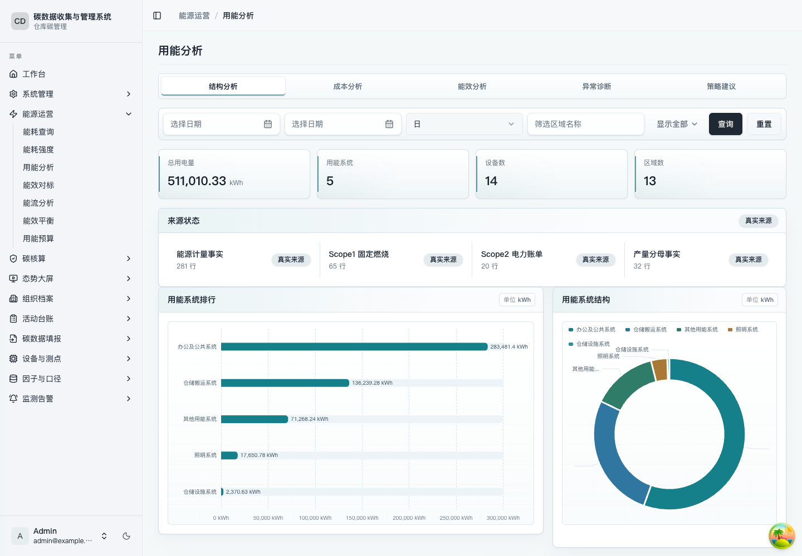

截图编号：`SHOT-DEMO-005`

### 2.4 查看能流分析

路径：`/energy/flow`

数据文件：

- 来自 `/energy/consumption` 已导入的能源事实。

操作步骤：

1. 打开「能流分析」。
2. 选择期间。
3. 点击「查询」。
4. 查看「能流图」「能量平衡表」「损耗诊断」「分析报告」。

系统结果：

- 系统自动把能源事实聚合为能流节点、边、平衡表和损耗诊断。
- 该页主要用于查看派生分析结果。

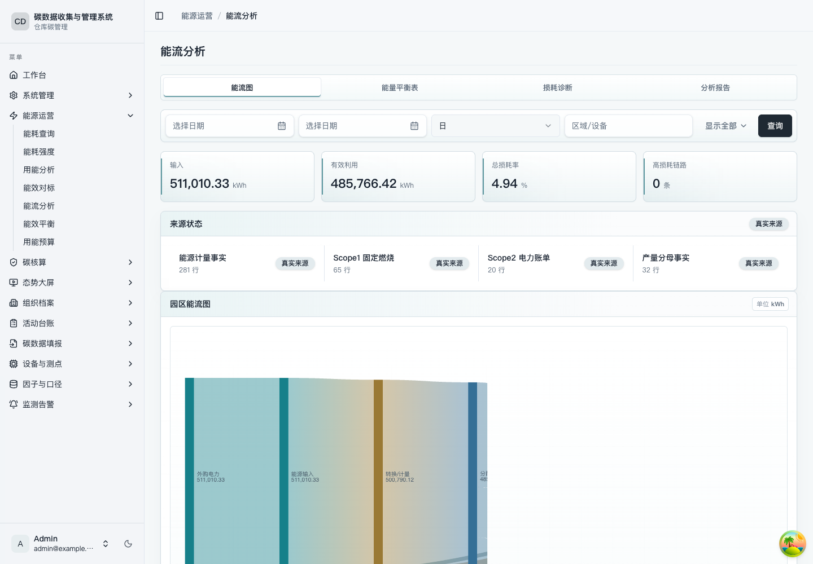

截图编号：`SHOT-DEMO-006`

### 2.5 执行能量平衡测算

路径：`/energy/balance`

数据文件：

- 来自 `/energy/consumption` 已导入的能源事实。

操作步骤：

1. 打开「能效平衡与优化」。
2. 选择期间，点击「查询」。
3. 查看「平衡简表」和「数据质量」。
4. 进入「优化测算」。
5. 点击「执行测算」。
6. 确认测算结果后点击「保存记录」。
7. 在「优化记录」查看已保存记录。

系统结果：

- 系统基于能源事实生成平衡结果。
- 一键测算结果保存后，可作为后续优化跟踪记录。

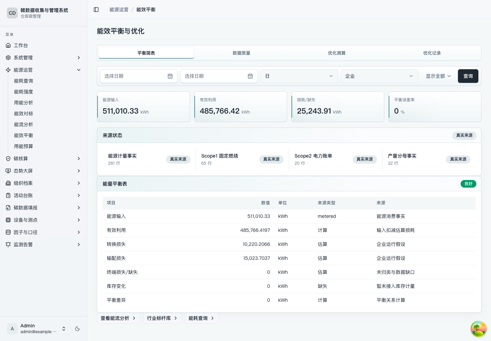

截图编号：`SHOT-DEMO-007`

### 2.6 完成能效对标

路径：`/energy/benchmark`

数据文件：

- `05_energy_management/energy_interval_facts.csv`
- `05_energy_management/production_output_facts.csv`

操作步骤：

1. 打开「能效对标」。
2. 在「历史基线」查看系统基于历史数据生成的基线。
3. 在「行业标杆库」点击「新增」或「CSV 导入」维护标杆项。
4. 选择标杆方案，点击「按最佳期间生成」「按 P25 生成」或「按均值生成」。
5. 查看「设备/工序对标」「对标结论」「整改建议」。

系统结果：

- 系统把历史能源和产量数据转换为可对比基线。
- 一键生成的标杆项会进入对标结论和整改建议。

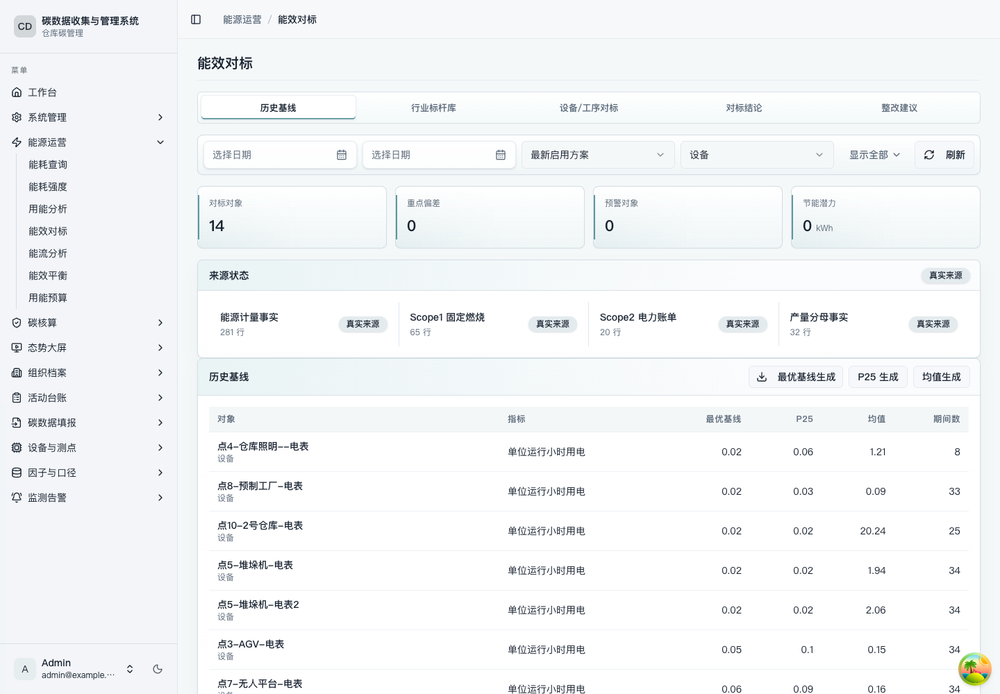

截图编号：`SHOT-DEMO-008`

### 2.7 建立能源与碳排预算

路径：`/energy/budget`

数据文件：

- 来自 `/energy/consumption` 已导入的能源事实和产量分母。

操作步骤：

1. 打开「用能与碳排放预算管理」。
2. 在「年度目标」点击「新增目标」。
3. 填写年度能源、碳排或强度控制目标并保存。
4. 在「月度预算」查看系统分解的月度预算。
5. 在「执行偏差」查看实际值、预算值和偏差。
6. 如需调整，进入「调整审批」点击「新增调整」。

系统结果：

- 系统基于历史能源和产量数据形成预算基线。
- 预算执行偏差自动随实际数据刷新。

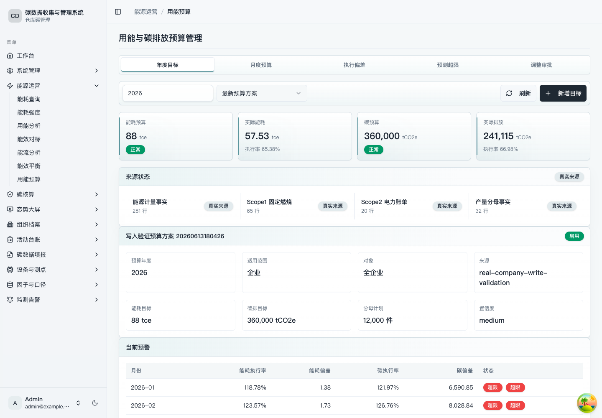

截图编号：`SHOT-DEMO-009`

## 第三阶段：组织碳核算

### 3.1 填报 Scope 活动数据并重建排放台账

路径：`/carbon/accounting`

数据文件：

- `01_carbon_accounting/scope1_stationary_combustion.csv`
- `01_carbon_accounting/scope2_electricity_bills.csv`
- `01_carbon_accounting/scope3_waste_disposal.csv`
- `01_carbon_accounting/emission_factors.csv`
- `01_carbon_accounting/carbon_accounting_batches.csv`
- `01_carbon_accounting/carbon_emission_inventory_items.csv`

操作步骤：

1. 打开「碳排放核算」。
2. 在「Scope1 填报」「Scope2 填报」「Scope3 填报」查看或补录活动数据。
3. 进入「排放台账」。
4. 点击「创建批次」或选择已有批次。
5. 点击「重建清单」。
6. 检查纳入清单数量、计算结果和缺结果记录。
7. 清单非空且无缺结果后，点击「提交」或「锁定」。

系统结果：

- 系统按组织边界、Scope 活动数据和因子生成排放清单。
- 重建清单是一键计算动作；用户不需要逐条手算 CO2e。

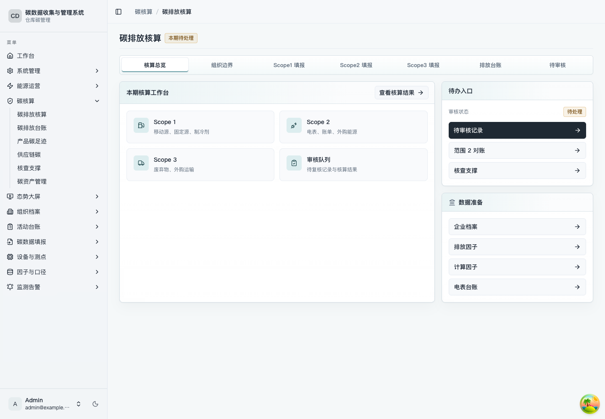

截图编号：`SHOT-DEMO-010`

## 第四阶段：产品碳足迹

### 4.1 建立产品碳足迹研究并生成结果

路径：`/carbon/product-footprint`

数据文件：

- `02_carbon_product_footprint/product_footprint_studies.csv`
- `02_carbon_product_footprint/product_system_boundaries.csv`
- `02_carbon_product_footprint/product_lifecycle_stages.csv`
- `02_carbon_product_footprint/product_footprint_inventory_items.csv`
- `02_carbon_product_footprint/product_footprint_results.csv`
- `02_carbon_product_footprint/production_output_facts.csv`
- `02_carbon_product_footprint/production_products.csv`

操作步骤：

1. 打开「产品碳足迹核算」。
2. 在「产品与研究」点击「新建研究」。
3. 选择产品，填写研究编号、声明单位和报告期间。
4. 在「生命周期边界」维护系统边界，并点击「保存边界」。
5. 在「生命周期边界」点击「新增阶段」维护阶段。
6. 在「活动数据清单」点击「新增活动数据」或「引用供应商数据」。
7. 在「分配与因子」维护分配规则。
8. 在「核算结果」点击「计算结果」。
9. 在「报告生成」点击「导出报告」。

系统结果：

- 系统基于生命周期阶段、活动清单、分配规则和因子计算产品碳足迹。
- 报告导出会生成包含报告正文、上下文、清单和质量摘要的文件包。

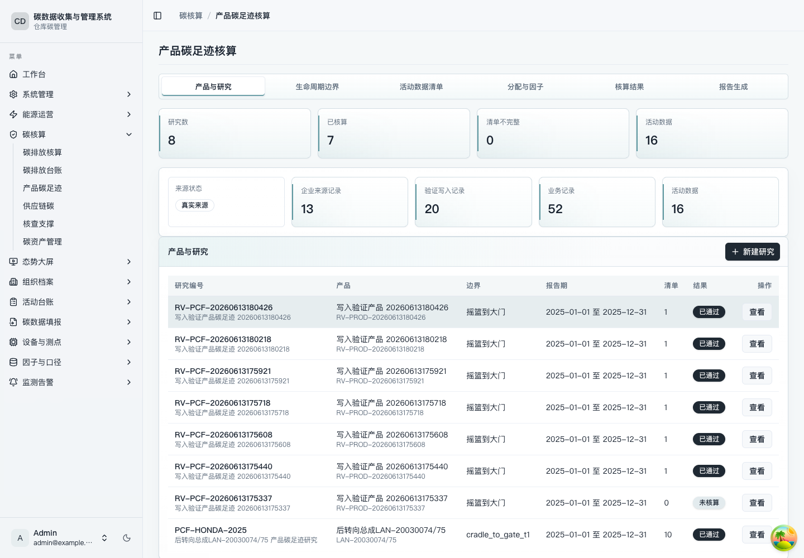

截图编号：`SHOT-DEMO-011`

## 第五阶段：供应链与核查

### 5.1 维护供应链碳数据

路径：`/carbon/supply-chain`

数据文件：

- `03_carbon_supply_chain/supply_chain_suppliers.csv`
- `03_carbon_supply_chain/supplier_sites.csv`
- `03_carbon_supply_chain/supplier_disclosure_tasks.csv`
- `03_carbon_supply_chain/supplier_carbon_data.csv`
- `03_carbon_supply_chain/source_files.csv`

操作步骤：

1. 打开「供应链碳管理」。
2. 在「供应商档案」点击「新建供应商」。
3. 点击「新增场站」维护供应商场站。
4. 在「填报任务」点击「新建任务」。
5. 选择任务后，在「数据审核」点击「新增填报数据」。
6. 点击「新增证据」登记证据文件。
7. 审核通过后，在「下游披露」点击「生成披露记录」。
8. 在「供应链分析」查看统计结果。

系统结果：

- 供应商、场站、任务、碳数据和证据形成一条可追溯链路。
- 披露记录生成后，可用于下游客户或内部协同。

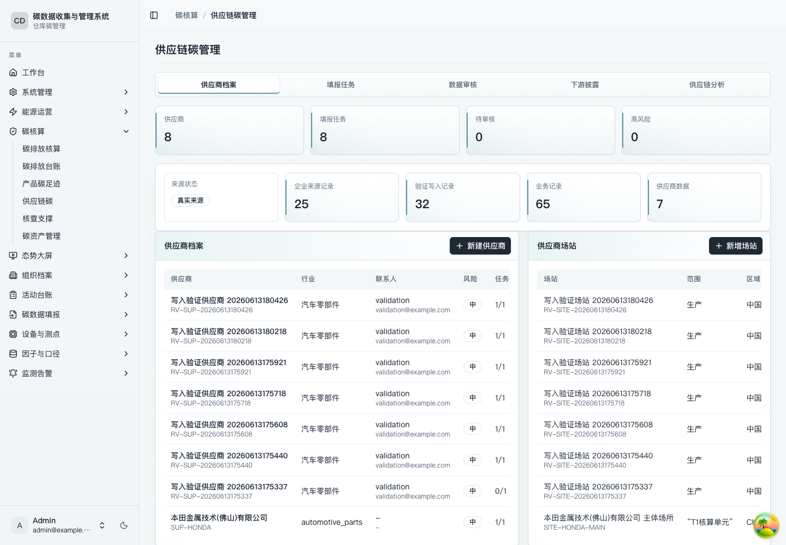

截图编号：`SHOT-DEMO-012`

### 5.2 生成核查材料包

路径：`/carbon/verification`

数据文件：

- `04_carbon_verification/carbon_verification_projects.csv`
- `04_carbon_verification/carbon_accounting_batches.csv`
- `04_carbon_verification/carbon_emission_inventory_items.csv`
- `04_carbon_verification/product_footprint_inventory_items.csv`
- `04_carbon_verification/product_footprint_results.csv`
- `04_carbon_verification/source_files.csv`

操作步骤：

1. 打开「碳核查支撑」。
2. 在「核查项目」点击「创建项目」或选择已有项目。
3. 在「凭证清单」检查凭证、附件路径和哈希。
4. 如凭证缺失，点击「登记附件」补齐。
5. 在「核查材料包」检查材料分组和 manifest。
6. 在「报告导出」点击「生成材料包」。
7. 在导出记录中点击「下载」。

系统结果：

- 系统自动汇总碳核算、产品碳足迹、供应链数据和附件索引。
- 一键生成核查材料包后，可下载用于审计或核查沟通。

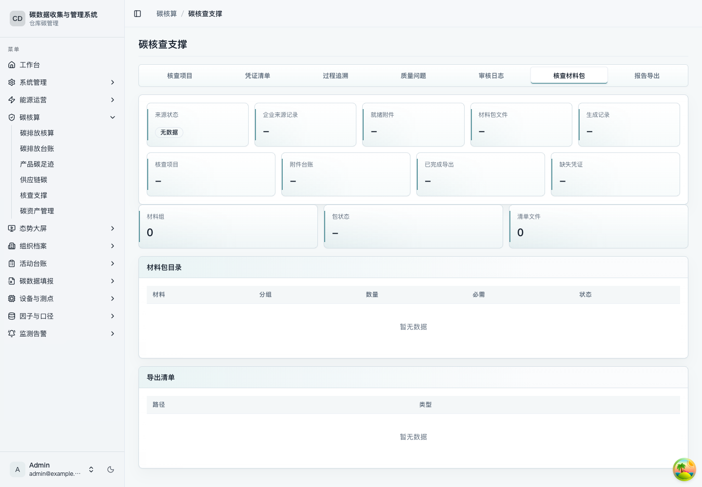

截图编号：`SHOT-DEMO-013`

## 第六阶段：碳资产

### 6.1 维护碳资产台账并完成履约预测

路径：`/carbon/assets`

数据文件：

- `06_carbon_assets/carbon_accounting_batches.csv`
- `06_carbon_assets/carbon_emission_inventory_items.csv`
- `06_carbon_assets/carbon_assets_assumptions.csv`

操作步骤：

1. 打开「碳资产」。
2. 先查看「资产来源」和「市场行情」。
3. 如需批量导入，点击「真实资产台账导入」，下载模板后上传或粘贴 CSV。
4. 在「履约周期」点击「新增周期」。
5. 点击「新增账户」维护账户。
6. 在「配额台账」点击「新增配额」。
7. 在「CCER/绿证」点击「新增持仓」。
8. 在「交易模拟」点击「新增模拟」进行交易测算。
9. 点击「新增清缴」登记履约清缴。
10. 在「滚动预测」点击「新增情景」，查看履约缺口和预测结果。
11. 在「风险预警」查看系统建议。

系统结果：

- 碳资产页面把履约周期、账户、配额、持仓、交易测算、清缴、行情和预测集中管理。
- 市场行情用于辅助判断成本变化；履约预测用于评估缺口和风险。

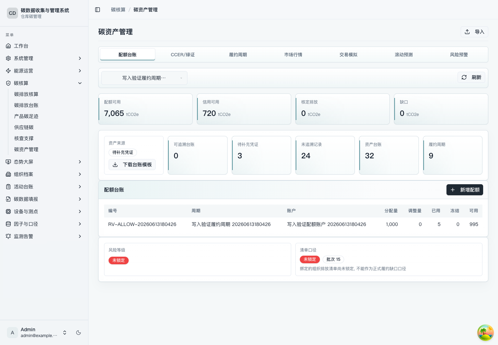

截图编号：`SHOT-DEMO-014`

## 截图清单

每张截图已嵌入对应操作步骤下方；本清单仅用于快速索引。

| 编号 | 页面 | 建议截图焦点 |
| --- | --- | --- |
| `SHOT-DEMO-001` | `/teams` | 星瀚样例租户与进入工作区入口 |
| `SHOT-DEMO-002` | `/carbon/accounting` | 组织边界、报告主体、报告期和发布状态 |
| `SHOT-DEMO-003` | `/energy/consumption` | 数据导入、导入结果和能源消费概览 |
| `SHOT-DEMO-004` | `/energy/intensity` | 产品强度或消费量汇总 |
| `SHOT-DEMO-005` | `/energy/analysis` | 结构分析、异常诊断或策略建议 |
| `SHOT-DEMO-006` | `/energy/flow` | 能流图和损耗诊断 |
| `SHOT-DEMO-007` | `/energy/balance` | 优化测算和优化记录 |
| `SHOT-DEMO-008` | `/energy/benchmark` | 历史基线、标杆项和对标结论 |
| `SHOT-DEMO-009` | `/energy/budget` | 年度目标、月度预算和执行偏差 |
| `SHOT-DEMO-010` | `/carbon/accounting` | Scope 填报、排放台账和重建清单结果 |
| `SHOT-DEMO-011` | `/carbon/product-footprint` | 产品研究、活动清单、核算结果和报告导出 |
| `SHOT-DEMO-012` | `/carbon/supply-chain` | 供应商、任务、填报数据、证据和披露 |
| `SHOT-DEMO-013` | `/carbon/verification` | 凭证清单、材料包和报告导出 |
| `SHOT-DEMO-014` | `/carbon/assets` | 台账导入、市场行情、履约预测和风险预警 |
