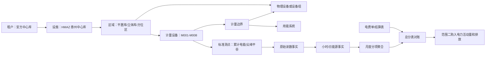

# 泰州中心库范围二电力结构化方案

- 更新时间：2026-08-10
- 方案状态：开发完成，待生产录入与迁移
- 适用租户：安方中心库（`anfang-center-warehouse`）
- 设施名称：国网江苏电力泰州中心库
- MDM 仓库编码：`HMAZ`
- 数据来源：设备台账、安方 8 块 MQTT 电表点位描述、线上数据库只读核对

## 1. 方案结论

安方范围二电力不应继续按“8 个临时电表名称 + 原始表码”组织。正确结构是把以下五类对象分开：

1. 仓库和区域：泰州中心库、平置库、立体库及方位分区。
2. 物理设备：叉车、起重机、AGV、输送线、检测装置等设备资产。
3. 计量设备：安方 1 至 8 号电表，是采集载体，不等同于被计量设备。
4. 测点：正向/反向、有功/无功、总/尖/峰/平/谷等累计读数。
5. 计量边界：一块表实际覆盖哪个区域、设备组或综合回路。

范围二正式核算以企业购入电力边界为准。当前 8 块表主要是分项表，适合做区域、设备用途和能流分配；在没有确认总进线表之前，不能把 8 块表之和直接认定为仓库全部购入电量。组织层购入电量优先使用客户电费单，分项表用于分配和对账，未覆盖部分进入“公共及未分项用电”。

数据时间范围不是本方案的阻塞条件。只要主数据、读数事实、计量边界和投影规则正确，后续采集数据会自然积累到小时、日、月和年度结果。

## 2. 设备台账识别结果

来源文件：[泰州中心库设备信息更新.xlsx](../设备台账/泰州中心库设备信息更新.xlsx)。

| 工作表/范围 | 可识别事实 | 结构化用途 |
| --- | --- | --- |
| `mdm仓库信息!A95:F96` | 泰州中心库正式编码为 `HMAZ`；祥泰仓库编码为 `HMA1` | 安方与祥泰保持独立设施和租户边界 |
| `叉车!A3:R8` | 6 台电动叉车，均有资产唯一码 | 建立 6 个独立物理设备资产 |
| `起重机!A3:R6` | 1 台桥式起重机、1 台精定位行吊、2 台悬臂式起重机 | 用于 M002、M005、M007 候选设备匹配 |
| `自动化及辅助设备!A3:N11` | 行吊、子母穿梭车、提升机、码垛机、检测装置、输送线、AGV 等 | 建立自动化设备和用能系统 |
| `计量设备!A3:Q3` | 1 台电子吊秤 | 属于物理计量设备，但不是电力电表 |

### 2.1 台账清洗要求

- `仓库编码` 当前显示 `#NAME?`，平台导入时应使用 MDM 表确认的 `HMAZ`，不能把 Excel 公式错误写入数据库。
- “精定位行吊”和“通用桥式起重机（线缆智能装卸行吊）”的型号、厂家和投运日期一致，极可能是同一物理资产在两个工作表重复登记。应以资产唯一码 `411011009201805029` 为主记录，自动化设备表记录作为分类补充，不创建两个设备。
- AGV 规格为 `8T/3T/2T`，数量为 `1,6,2`。在缺少单车资产编号时，先建立 3 个设备组（8T×1、3T×6、2T×2），不能虚构 9 个资产唯一码。
- 两台悬臂式起重机的台账资产唯一码为“无”，应生成平台内部编码，同时保留“来源资产码缺失”状态。
- 充电桩、立体堆垛机和照明回路没有在当前台账中形成独立资产，是需要补充的设备主数据，不应强行映射到无关设备。

## 3. 目标概念模型



### 3.1 区域不是设备

点位描述中的“平置库东北”“立体库南”属于空间位置，应进入 `MonitorSector` 区域树；“充电桩”“AGV”“行吊”属于设备或用能系统，不应塞入区域名称。

建议区域树：

| 区域编码 | 区域名称 | 类型 | 上级区域 |
| --- | --- | --- | --- |
| `HMAZ` | 国网江苏电力泰州中心库 | site | 无 |
| `HMAZ-PZK` | 平置库 | warehouse | `HMAZ` |
| `HMAZ-LTK` | 立体库 | warehouse | `HMAZ` |
| `HMAZ-PZK-NE` | 平置库东北区 | zone | `HMAZ-PZK` |
| `HMAZ-PZK-SE` | 平置库东南区 | zone | `HMAZ-PZK` |
| `HMAZ-PZK-C` | 平置库中部区 | zone | `HMAZ-PZK` |
| `HMAZ-PZK-SW` | 平置库西南区 | zone | `HMAZ-PZK` |
| `HMAZ-PZK-W` | 平置库西部区 | zone | `HMAZ-PZK` |
| `HMAZ-LTK-S` | 立体库南区 | zone | `HMAZ-LTK` |
| `HMAZ-LTK-N` | 立体库北区 | zone | `HMAZ-LTK` |

### 3.2 物理设备不是电表

物理设备继续使用 `MonitorEquipment` 承载，并通过 `DeviceType` 区分叉车、起重机、AGV、输送线、检测设备、充电设施和电表。电表保留为 `category=0` 的计量设备；普通资产不设置为电表类别。

设备主数据至少包括：

- 平台设备编码和名称。
- 设备类型、型号、厂家、产权单位。
- 台账资产唯一码或内部替代编码。
- 所属仓库 `HMAZ` 和当前区域。
- 设备状态、投运日期和台账来源。
- 是否为计量设备、是否为用能设备。

### 3.3 电表和被计量对象之间需要“计量边界”

`MonitorEquipment.sector_id` 只能说明电表安装在哪里，不能表达它实际测量哪些设备。建议新增：

#### `metering_measurement_boundary`

| 字段 | 含义 |
| --- | --- |
| `team_id` | 租户隔离 |
| `code` / `name` | 租户内唯一的计量边界 |
| `meter_equipment_id` | 对应电表设备 |
| `sector_id` | 边界所在区域 |
| `use_system_code` | 充电、吊装、AGV、照明检测、立体自动化等用能系统 |
| `boundary_type` | `direct_meter`、`group_meter`、`composite_circuit`、`boundary_import` |
| `energy_direction` | 购入、输出、发电、储能充电/放电等方向；安方首期为购入分项 |
| `valid_from` / `valid_to` | 映射有效期 |
| `source_name` | 点位表、设备台账或现场确认记录 |
| `confidence_level` | 已确认、候选、待确认 |

#### `metering_measurement_boundary_member`

| 字段 | 含义 |
| --- | --- |
| `boundary_id` | 所属计量边界 |
| `equipment_id` | 被计量的单台设备或设备组，可为空 |
| `sector_id` | 区域综合负荷成员，可为空 |
| `member_role` | 直接设备、设备组成员、区域公共负荷 |
| `allocation_weight` | 仅在有业务依据时设置分配权重 |
| `valid_from` / `valid_to` | 成员关系有效期 |

这样可以表达：M005 直接计量一台行吊；M008 计量叉车充电系统并关联多台叉车；M006 同时覆盖区域照明和检测设备；M007 覆盖堆垛机与旋转吊组合系统。

## 4. 安方 8 块电表目标映射

电表技术编码 `SZXC-3D309D26-M001` 至 `M008` 应保持不变，避免破坏采集绑定；业务名称、资产编码、区域和边界另行补齐。

| 电表 | 业务名称 | 区域 | 用能系统 | 边界类型 | 台账关联判断 | 当前确认项 |
| --- | --- | --- | --- | --- | --- | --- |
| M001 | 平置库东北充电设施电表 | `HMAZ-PZK-NE` | `charging` | group_meter | 台账未列充电桩资产 | 补充充电桩数量、用途和服务车辆 |
| M002 | 平置库东南起重设备电表（暂定） | `HMAZ-PZK-SE` | `lifting` | 待确认 | 候选为桥式起重机或其他行车 | 确认原点位“行”的完整名称和设备资产 |
| M003 | 平置库中部 AGV 系统电表 | `HMAZ-PZK-C` | `agv_logistics` | group_meter | 对应 AGV 设备组，规格 8T×1、3T×6、2T×2 | 确认该表是否含 AGV 充电、调度及配套设备 |
| M004 | 平置库西南充电设施电表 | `HMAZ-PZK-SW` | `charging` | group_meter | 台账未列充电桩资产 | 与 M001 区分服务对象和计量回路 |
| M005 | 平置库西南线缆装卸行吊电表 | `HMAZ-PZK-SW` | `lifting` | direct_meter | 高概率对应精定位行吊/线缆智能装卸行吊，同一资产码 `411011009201805029` | 现场确认后合并重复台账记录并绑定 |
| M006 | 平置库西部照明与检测综合电表 | `HMAZ-PZK-W` | `lighting_inspection` | composite_circuit | 检测部分候选为称重及外形检测装置；照明为区域负荷 | 确认照明、检测及其他回路覆盖范围 |
| M007 | 立体库南部堆垛与旋转吊系统电表 | `HMAZ-LTK-S` | `automated_storage` | composite_circuit | 旋转吊候选为 2 台悬臂式起重机；堆垛机未在台账中独立列示 | 补充堆垛机资产并确认两台悬臂吊归属 |
| M008 | 立体库北部叉车充电系统电表 | `HMAZ-LTK-N` | `forklift_charging` | group_meter | 台账有 6 台电动叉车及独立资产码 | 确认 6 台叉车是否均由该回路充电及充电桩资产 |

映射置信度规则：区域和用能系统可以先按现有点位描述落库；具体物理设备只对高置信匹配创建正式成员关系。M002、M006、M007、M008 的设备成员需要现场确认后生效。

## 5. 标准测点和原始读数

本地代码已经定义 20 个 SZSCADA 电表测点：

| 测点组 | 标准点位 | 主要用途 |
| --- | --- | --- |
| 正向有功 | 总、尖、峰、平、谷 | 购入电力用量、分时成本和范围二活动量 |
| 反向有功 | 总、尖、峰、平、谷 | 输出/返送电量；只有业务确认后才进入能流 |
| 正向无功 | 总、尖、峰、平、谷 | 功率因数和电能质量分析，不作为范围二活动量 |
| 反向无功 | 总、尖、峰、平、谷 | 电能质量分析，不作为范围二活动量 |

`DevicePoint` 负责定义“采什么”；`MeterReadingFact` 负责保存“某时刻读到了什么”。累计表码和区间用电量必须分开：

- `forward_active_total + register_index` 是累计表码。
- 相邻有效累计表码的差值才是区间用电量。
- 尖峰平谷累计值应分别求差，不从总电量按比例拆分。
- 反向和无功数据保留，但不得混入购入电力活动量。
- 原始值、折算值、单位、质量、采集时间、来源消息和映射版本都要保留。

## 6. 当前线上链路与迁移风险

### 6.1 已确认的线上事实

- 截止 2026-08-09 高水位，安方已有 3,164 条原始 MQTT 消息和 506,240 条统一测点事实，数量关系为 `3,164 × 8 × 20`。
- 506,240 条测点事实中 455,005 条质量为有效、51,235 条为无效；160 个电表测点组合均存在，没有孤立消息。
- `dataapp_ammeterindexvalue` 中另有 22,767 条安方兼容记录。这些记录来源于同一批 MQTT 消息，不作为第二份来源再次迁移。
- 安方采集链已具备 `MqttInboundMessage -> MqttDeviceBinding -> MeterReadingFact`，当前主要缺口是正式区域、设备用途、计量边界、投影和对账，不是原始消息为空。
- 线上数据库 Alembic 仍登记在 `a6b7c8d9e0f`，但 IoT 结构已经存在，属于结构与版本登记不一致。

### 6.2 已完成的迁移修复

迁移链已调整为非破坏性路径：

1. `6d7e8f9a0b1c` 在 IoT 表全部存在时执行列结构校验和 RLS 修复，不重复建表；只存在部分表时中止。
2. `7e8f9a0b1c2d` 不再删除 `dataapp_iottelemetry`，兼容表继续只读保留。
3. `8f9a0b1c2d3e` 只把 MQTT 点表升级为统一事实表和规范化 20 点编码，不回填全部旧历史，不删除 `dataapp_ammeterindexvalue`，不删除旧统计视图。
4. 祥泰旧数据通过 `app metering migrate-legacy` 按旧表 ID 断点续跑，只迁移 `source_message_id is null` 的独立来源行；安方已关联 MQTT 的兼容行明确跳过。
5. 旧表和旧视图至少保留两个发布周期。本阶段不提供数据库 downgrade，异常时使用 worker 和查询开关回滚。

空库升级和“结构已存在但版本停在 `a6...`”两种路径均已在临时 PostgreSQL 验证到 `9a0b1c2d3e4f`，旧电表表和旧遥测表保持存在。

## 7. 范围二数据投影规则

### 7.1 从表码到能源事实

```text
累计表码 MeterReadingFact
  -> 按租户 + 电表 + 点位排序
  -> 质量校验、倍率换算、复位和缺口识别
  -> 区间电量 delta_kWh
  -> 小时 EnergyIntervalFact
  -> 日 EnergyIntervalFact
  -> 月度 Scope2MeterAggregate
```

投影要求：

- 使用采集时间，不使用数据库写入时间代替。
- 只对相邻有效累计值求差；负差值进入复位/换表问题，不直接取绝对值。
- 倍率由设备绑定配置决定，明确“上游已折算”或“平台乘 CT/PT 倍率”。
- 每条派生事实快照保存当时的区域、计量边界和用能系统，后续改映射不静默改变历史。
- `source_record_id` 必须稳定，重跑投影采用 upsert 或先清理同一投影批次，不能重复累计。
- 缺口保留为质量状态，不为了图表连续而生成无来源的正式电量。

### 7.2 组织层范围二与分项电量

建议增加月度对账对象 `Scope2ElectricityReconciliation`：

| 字段 | 含义 |
| --- | --- |
| `billing_month` | 账期 |
| `bill_record_id` | 电费单记录 |
| `boundary_meter_id` | 总进线表，可为空 |
| `bill_kwh` | 电费单购入电量 |
| `boundary_meter_kwh` | 总表电量，可为空 |
| `submeter_kwh` | 8 块分项表合计 |
| `unallocated_kwh` | 购入电量扣除有效分项后的未分项电量 |
| `coverage_status` | 完整、部分、待确认 |
| `reconciliation_note` | 差异原因和处理记录 |

正式活动量口径：

- 有电费单、无确认总表：组织 Scope 2 使用电费单购入电量。
- 有确认总表和电费单：以项目确认的结算口径形成活动量，同时保留差异。
- 8 块分项表用于区域和用途分配，不与电费单重复相加。
- 充电桩电量已经属于购入电力，不能再按电动叉车或 AGV 单独增加一遍 Scope 2。
- 未覆盖电量作为“公共及未分项用电”保留，不能强制摊入某台设备。

### 7.3 碳排放结果

月度组织范围二结果由“正式购入电量 × 适用报告期排放因子”生成。因子必须保存来源、年度、单位、适用范围和计算批次。区域、用能系统和设备层排放是组织结果的分配视图，不应产生超过组织总量的新增排放。

## 8. 对 12 页面提供的数据

| 页面 | 直接读取的数据 | 结构化后的结果 |
| --- | --- | --- |
| 能耗查询 | `EnergyIntervalFact` | 按仓库、区域、电表、用能系统查询 |
| 能源强度 | 能源事实 + WMS/工作量 | 形成同报告期单位吞吐、设备工时强度 |
| 能源分析 | 能源事实 + 质量问题 | 趋势、结构和异常不再读取临时名称 |
| 能效对标 | 用能系统 + 设备工作量 | 充电、吊装、AGV、自动化系统分别比较 |
| 能流分析 | 区域树 + 计量边界 + 电量 | 购入电力 → 平置/立体库 → 用能系统 → 设备组 |
| 能量平衡 | 电费单/总表 + 分项表 | 展示已分项和未分项，不把分项和总量相加 |
| 能源与碳预算 | 月度事实 + 电价 + 经营计划 | 预算执行按统一电力事实计算 |
| 碳排放核算 | 正式购入电量 + 因子 | 生成可追溯 Scope 2 月度活动量和排放 |
| 产品碳足迹 | 经确认的能源分配结果 | 只有明确产品/业务分配依据时才引用 |
| 供应链碳管理 | 组织或作业环节排放结果 | 不直接读取原始电表表码 |
| 碳核查支撑 | 电费单、对账、因子、批次 | 输出来源一致的证据链 |
| 碳资产管理 | 已锁定组织排放清单 | 不从分项电表直接推导履约缺口 |

## 9. 实施顺序

### Phase A：主数据确认

1. 建立 `HMAZ` 区域树。
2. 清洗并导入设备台账，处理行吊重复记录和 AGV 设备组。
3. 保留 8 块表技术编码，补业务名称、资产编码、区域和仓库字段。
4. 现场确认 M002、M006、M007、M008 的具体计量边界。
5. 补充充电桩、堆垛机和照明回路资料。

验收：区域、物理设备、电表三类对象在页面和数据库中不再混用。

### Phase B：模型和迁移安全

1. 新增计量边界及成员模型。
2. 修复统一读数迁移，改为非破坏性双表迁移。
3. 为 8 块表建立 MQTT 设备绑定和 20 点映射，状态由临时改为已确认。
4. 增加迁移计数、非空点位数、租户隔离和幂等测试。

验收：旧数据完整保留，新消息只写一次，可从统一事实追溯来源。

### Phase C：能源事实投影

1. 建立累计表码到小时/日事实投影。
2. 快照区域、用能系统和计量边界。
3. 建立质量问题和可重跑投影批次。
4. 生成安方月度分项聚合。

验收：任意一条月度分项电量可追溯到小时事实和原始累计表码。

### Phase D：范围二闭环

1. 导入电费单和峰平谷数据。
2. 建立总表/账单/分项表对账。
3. 形成组织范围二活动量、区域分配和排放结果。
4. 接入能流、平衡、核算、核查和大屏。

验收：组织总量只有一个正式来源，分项分配合计不超过组织总量，未覆盖部分明确保留。

## 10. 开发任务拆分

| 编号 | 任务 | 主要模块 | 优先级 | 状态 |
| --- | --- | --- | --- | --- |
| AF-S2-01 | 导入 `HMAZ` 区域树 | `master_data` | P0 | 接口完成，待生产导入 |
| AF-S2-02 | 清洗设备台账并建立物理设备资产 | `master_data` | P0 | 接口完成，待正式工作簿 |
| AF-S2-03 | 补齐 8 块电表业务主数据 | `master_data` / `metering` | P0 | 接口完成，待正式工作簿 |
| AF-S2-04 | 现场确认 4 个复合/设备组计量边界 | 实施 | P0 | 待现场确认 |
| AF-S2-05 | 新增计量边界和成员模型 | `metering` | P0 | 完成 |
| AF-S2-06 | 修复统一读数迁移的数据丢失风险 | 数据库迁移 | P0 | 完成，待生产执行 |
| AF-S2-07 | 建立 MQTT 设备绑定和 20 点映射 | `iot_ingestion` | P0 | 20 点事实已存在，业务绑定待工作簿确认 |
| AF-S2-08 | 建立小时/日能源事实投影 | `energy` | P0 | 完成，待生产执行 |
| AF-S2-09 | 建立投影质量问题和重跑批次 | `metering` / `energy` | P0 | 完成 |
| AF-S2-10 | 生成月度分项聚合 | `energy` / `carbon_accounting` | P0 | 完成，待生产执行 |
| AF-S2-11 | 导入电费单并建立月度对账 | `carbon_accounting` | P1 | 对账完成，待真实账单 |
| AF-S2-12 | 生成 Scope 2 活动量和排放快照 | `carbon_accounting` | P1 | 完成，待因子和生产执行 |
| AF-S2-13 | 接入能源 7 页面、碳核算和大屏 | 前端 / `analytics` | P1 | 当前版本事实查询已接入，待页面数据验收 |

## 11. 必要测试

- 区域树、设备、电表和计量边界全部按 `team_id` 隔离。
- 一块表可覆盖多个设备，一台设备可随时间更换电表。
- 重复 MQTT 消息不生成重复读数。
- 安方原始消息数 × 8 块表 × 20 点等于统一事实数，兼容旧表记录不重复迁移。
- 累计值相同、负差值、复位、缺口、无效值和乱序分别产生正确质量结果。
- `legacy_quantity` 和 `register_index` 不会被同时计入区间用电。
- 重跑小时、日、月投影不改变无新增来源时的结果。
- 电费单、总表和分项表不会重复计入 Scope 2。
- M006/M007 等综合回路不会因为多个边界成员而重复复制整表电量。
- 祥泰与安方切换租户后，区域、设备、读数、聚合和排放结果互不可见。

## 12. 现场确认清单

1. M002 点位完整名称及对应起重机资产。
2. M001、M004 分别服务哪些充电桩、叉车或 AGV。
3. M003 是否只含 AGV 充电，还是还包括调度、输送或其他配套设备。
4. M005 是否对应资产码 `411011009201805029` 的线缆智能装卸行吊。
5. M006 是否同时计量照明和称重外形检测装置，是否还包含其他辅助负荷。
6. M007 的堆垛机型号/数量，以及“旋转吊”是否对应两台悬臂式起重机。
7. M008 是否覆盖设备台账中的全部 6 台电动叉车。
8. 是否存在仓库总进线表、结算表或其他未纳入的分项表。
9. 8 块表的 CT/PT 倍率、上游是否已折算、正反向定义和换表记录。
10. MQTT 网关是否具备断网缓存、补发和稳定电表通信地址。

完成以上确认后，安方 8 块电表即可从“临时采集点”升级为可持续积累、可对账、可核算、可生成能流的正式范围二数据体系。
