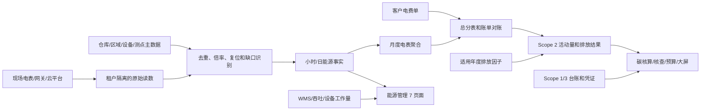

# 泰州四仓能碳数据治理与开发跟踪

- 更新时间：2026-08-10
- 跟踪状态：进行中
- 适用租户：祥泰仓库、安方中心库、姜堰仓库、泰兴仓库
- 关联页面：能碳中心 12 个业务功能页面及大屏
- 线上基线：2026-08-09 华为仓储平台数据库只读核对结果

专项实施方案：

- [泰州中心库范围二电力结构化方案.md](./泰州中心库范围二电力结构化方案.md)：设备台账清洗、区域/设备/电表/测点/计量边界建模、统一读数迁移、能源事实投影和 Scope 2 对账方案。
- [祥泰安方真实数据录入与迁移实施手册.md](./祥泰安方真实数据录入与迁移实施手册.md)：生产预检、外部备份、迁移命令、采集切换、验收和回滚步骤。

## 1. 目标与边界

本专项用于跟踪泰州四个仓库从“设备接入和页面可用”走向“数据可持续、可计算、可追溯”的建设工作，重点解决：

1. 安方中心库已经接入 8 块电表，但区域、设备用途、聚合事实和 Scope 2 核算链路尚未形成。
2. 祥泰仓库数据种类较丰富，但原始时序、小时/日事实、月度聚合、电费账单和碳核算的时间范围不一致。
3. 姜堰、泰兴仓库尚未进入现场安装和持续采集阶段，需要在施工验收时同步完成数据主数据建档。
4. 范围一、范围三、仓储吞吐、设备工作量和凭证资料尚未形成四仓统一收集机制。
5. 开发期生成数据需要保留用于回归和展示，但不得进入正式核算、正式报表和客户侧业务结论。

本文件记录实施事实、开发任务和验收口径，不替代项目实施方案、客户收资清单或标准研究文件。

## 2. 数据治理原则

### 2.1 数据来源分层

| 分层 | 数据类型 | 典型来源 | 正式业务用途 |
| --- | --- | --- | --- |
| A | 现场自动采集 | 云集电表、安方 MQTT、网关缓存、现场 SCADA | 可进入质量校验，校验通过后形成能源事实 |
| B | 客户业务资料 | 电费单、燃料台账、维修工单、WMS/TMS/ERP、运输和废弃物凭证 | 经字段校验和业务确认后进入活动台账 |
| C | 平台计算派生 | 小时/日/月用能、强度、能流、Scope 2 排放、预算偏差 | 必须能追溯到 A/B 类来源、因子版本和计算批次 |
| D | 开发期生成或历史展示数据 | 开发种子、页面验证写入、基于真实趋势生成的汇报数据 | 保留用于开发回归；不得进入正式数据集或对外结论 |

约束：

- A、B、C、D 四类数据必须在后端保留可判定的来源属性，正式查询和核算批次只读取满足正式口径的数据。
- D 类记录不删除；通过数据集、来源策略或正式查询视图与生产业务结果隔离。
- 客户侧页面不显示 `demo_seed`、`manual_demo`、`mock` 等开发术语，也不把 D 类结果展示为企业真实结论。
- 现场缺失数据不得无标识插值后进入正式核算。无法回补时保留缺口，并在月度完整性和对账结果中体现。
- 四个仓库按独立租户管理，能流、碳排放和经营数据不得跨租户混用。跨仓比较只能读取各租户已确认的汇总结果。

### 2.2 标准与口径

- 综合能耗和能源折算参照 `GB/T 2589-2020` 及仓库适用的能源品种配置。
- 能量平衡和能流图参照 `GB/T 3484-2009`、`GB/T 28749-2012`。
- 能效基准和绩效指标参照 `GB/T 36713-2018`、`GB/T 36714-2018`。
- Scope 1/2/3 计算因子必须按报告期、地区、用途和来源版本配置，不在页面或聚合任务中硬编码。
- 具体标准记录和术语继续维护在 [能碳标准与术语知识库.md](./能碳标准与术语知识库.md)。

## 3. 线上数据基线

### 3.1 范围二电力

| 检查项 | 祥泰仓库 | 安方中心库 | 当前判断 |
| --- | --- | --- | --- |
| 原始与统一事实 | 旧表 1,331,340 条 | 3,164 条原始 MQTT 消息、506,240 条 20 点事实；兼容旧表 22,767 条 | 安方统一事实已完整存在，不从兼容旧表重复迁移 |
| 电表数量 | 旧表涉及 20 个标识；规范化起点后 14 块表有数据 | 8 块表、160 个电表测点组合 | 安方 8 块表当前均有点位事实 |
| 原始数据时间范围 | 2023-03-21 至 2026-08-09 | 2026-07-10 至 2026-08-09 | 安方历史范围明显不足 |
| 采样周期 | 主要为 15 分钟 | 主要为 5 分钟 | 后续聚合需按数据源配置周期 |
| 区域主数据 | 30 个区域节点 | 0 | 安方未建立平置库/立体库层级 |
| 设备业务映射 | 20 块表均已关联区域，覆盖 17 个点位节点 | 8 个设备均为临时名称，区域、位置、仓库用途为空 | 安方尚未完成业务语义建模 |
| 小时/日能源事实 | 169053 条，覆盖 14 块表，截止 2025-12-18 | 0 | 祥泰处理未跟上原始数据，安方尚未处理 |
| Scope 2 月度聚合 | 433 条，覆盖 15 块表，截止 2025-12 | 0 | 两仓均需重建到当前已完成账期 |
| 电力账单 | 2026-01 至 2026-06 共 6 条开发期记录，不能作为正式账单 | 0 | 两仓均需收集真实账单、户号、费用和凭证 |
| 能流图基础 | 已有仓库、区域、点位层级 | 无正式层级 | 安方暂不能形成真实分区能流 |

说明：安方 506,240 条测点事实等于 3,164 条消息 × 8 块表 × 20 点，其中 455,005 条质量为有效、51,235 条为无效；截止该高水位没有孤立消息。祥泰 `dataapp_scope2meteraggregate` 当前数据库状态为 `draft`，这是现有业务审批状态；现有聚合中还存在 `invalid_delta` 和 `insufficient_data` 记录，需要重建和校核。

### 3.2 安方连续性问题

- 1、3、4、5、6、7、8 号电表在 `2026-07-19 05:30:46` 至 `2026-08-07 03:25:50` 之间存在约 19 天连续缺口。
- 2 号电表从 `2026-08-07 03:25:50` 才开始形成记录，缺少此前时段。
- 当前 8 块表已恢复约 5 分钟周期更新，但“当前有数”不能替代历史完整性验收。
- 原始记录已带 `team_id`、`source_message_id` 和 `mapping_version`，可作为去重和映射版本治理基础。

### 3.3 安方点位目标映射

| 电表 | 所属仓库 | 方位/区域 | 设备用途 | 主数据处理要求 |
| --- | --- | --- | --- | --- |
| 安方 1 号 | 平置库 | 东北 | 充电桩 | 建立平置库区域节点并关联设备、电表 |
| 安方 2 号 | 平置库 | 东南 | 行，正式名称待现场确认 | 确认设备类型和名称后再进入用途统计 |
| 安方 3 号 | 平置库 | 中部 | AGV | 建立 AGV 用能系统关联 |
| 安方 4 号 | 平置库 | 西南 | 充电桩 | 与 1 号表区分点位，不合并原始记录 |
| 安方 5 号 | 平置库 | 西南 | 行吊 | 建立装卸/搬运用能系统关联 |
| 安方 6 号 | 平置库 | 西部 | 照明检测 | 现场确认是照明回路、检测回路或合并回路 |
| 安方 7 号 | 立体库 | 南部 | 立体堆垛机和旋转吊 | 标识组合设备和计量边界 |
| 安方 8 号 | 立体库 | 北部 | 叉车充电桩 | 建立充电用能系统关联 |

实施时同时维护设备名称、设备编码、所属区域、仓库、能源品种、计量方向、倍率、采集方式、外部设备编号和启用状态。不能只改页面显示名称。

### 3.4 其他业务数据

| 数据域 | 祥泰仓库 | 安方中心库 | 风险判断 |
| --- | --- | --- | --- |
| Scope 1 固定燃烧 | 12 条 | 0 | 祥泰需核验发票、领用或月结来源 |
| Scope 1 移动燃烧 | 12 条 | 0 | 需区分燃油车辆与电动叉车，避免与 Scope 2 重复 |
| Scope 1 制冷剂 | 7 条 | 0 | 需以设备台账、维修和补充记录为依据 |
| Scope 3 第三方运输 | 12 条 | 0 | 需从运单、TMS 或承运商对账资料补充 |
| Scope 3 废弃物 | 12 条 | 0 | 需补处置凭证、重量和处置方式 |
| 员工通勤 | 44 条 | 0 | 可采用年度调查，优先级低于电力、运输和废弃物 |
| 仓储吞吐/产量事实 | 27661 条，主要覆盖 2023 至 2024 年 | 0 | 祥泰数据已过期，无法支撑当前强度计算 |
| 设备工作量 | 8988 条，截止 2025 年 | 0 | 与 2026 年电力时段不一致 |

祥泰部分 Scope 1/3 记录的内部来源字段包含开发期生成或人工示例标记。此类记录按 D 类管理：保留原记录，但不得计入正式盘查、核查材料和客户结论。是否转为正式数据，只能依据客户凭证和业务确认，不依据页面是否已有数值。

## 4. 目标数据链路

必须区分：

- 原始读数是不可覆盖的来源事实。
- 小时、日、月数据是可重建的派生事实。
- 电费单是外部校核依据，不应直接替代所有分项电表。
- 能流、强度、预算和排放是消费上述事实的分析结果，不作为独立收资对象。

## 5. 开发与实施任务

状态统一使用：`已确认`、`待开发`、`待收资`、`待现场确认`、`待实施`、`进行中`、`待验收`、`完成`。

### 5.1 P0：范围二电力闭环

| 编号 | 任务 | 主要对象 | 当前状态 | 完成标准 |
| --- | --- | --- | --- | --- |
| EC-P0-01 | 建立安方平置库、立体库及子区域主数据 | `dataapp_monitorsector` | 开发完成，待导入 | 8 块表均可沿区域树追溯到所属仓库 |
| EC-P0-02 | 把安方 8 块临时电表映射为正式设备用途 | `dataapp_monitorequipment` | 导入能力完成，待现场确认 | 名称、位置、区域、用途、倍率和计量方向完整；2、6、7 号边界经现场确认 |
| EC-P0-03 | 回补安方 7 月 19 日至 8 月 7 日缺口及 2 号表历史 | 网关缓存、厂家平台、原始消息 | 待收资 | 可回补数据写入原始层并去重；不可回补时形成明确缺口记录 |
| EC-P0-04 | 统一祥泰 15 分钟与安方 5 分钟原始读数处理 | Metering / Energy 投影任务 | 开发完成，待生产迁移 | 按数据源采样周期、倍率和表码复位规则生成一致的小时/日事实 |
| EC-P0-05 | 重建祥泰能源事实和 Scope 2 月度聚合到当前账期 | `dataapp_energyintervalfact`、`dataapp_scope2meteraggregate` | 开发完成，待生产执行 | 覆盖所有纳入核算的有效电表；不再停留在 2025 年 |
| EC-P0-06 | 首次生成安方小时、日、月能源事实 | 同上 | 开发完成，待主数据导入 | 可按平置库、立体库、设备用途和月份查询 |
| EC-P0-07 | 建立电费单导入和总分表对账 | `dataapp_scope2electricitybill`、对账读模型 | 开发完成，待收资 | 两仓已完成账期均有账单；差异、缺失和未覆盖点位可追溯 |
| EC-P0-08 | 建立时序质量检查和采集中断告警 | Metering 质量任务、告警 | 质量投影完成，告警待开发 | 重复、缺口、负差值、复位、突增、固定值已进入质量问题；补采集新鲜度告警 |
| EC-P0-09 | 配置适用年度 Scope 2 因子并保存计算快照 | 因子库、核算批次 | 待收资 | 每个排放结果可追溯因子来源、年度、单位和批次 |
| EC-P0-10 | 增加租户隔离和跨租户写入回归测试 | 后端集成测试 | 完成 | 祥泰、安方原始及派生数据互不可见、不可误写 |

### 5.2 P1：四仓业务数据补齐

| 编号 | 任务 | 数据范围 | 当前状态 | 完成标准 |
| --- | --- | --- | --- | --- |
| DC-P1-01 | 发布四仓统一月度收资模板 | 2026 年 5 月起 | 完成 | 模板覆盖电费、Scope 1/3、吞吐、工作量和凭证索引 |
| DC-P1-02 | 收集四仓电费单和峰平谷费用 | 范围二、电力成本 | 待收资 | 每仓每月有账期、户号、电量、金额和原始附件 |
| DC-P1-03 | 收集固定燃烧、移动燃烧和制冷剂记录 | Scope 1 | 待收资 | 有活动量、单位、期间、设施/车辆/设备及凭证 |
| DC-P1-04 | 收集第三方运输、废弃物和必要的员工通勤数据 | Scope 3 | 待收资 | 运输和废弃物优先形成月度台账，通勤按适用性确认 |
| DC-P1-05 | 恢复祥泰 WMS 增量并建立四仓吞吐数据接口/导入 | 入库、出库、托盘、订单、重量 | 待开发 | 电力与经营分母处于相同报告期，可计算强度 |
| DC-P1-06 | 建立设备工作量数据 | 运行小时、充电次数、搬运量 | 待开发 | 关键设备工作量可与电表和区域关联 |
| DC-P1-07 | 建立附件和来源追溯 | 电费单、发票、工单、运单、处置凭证 | 后端完成，待页面验收 | 正式记录可查看必要来源并用于核查材料包 |
| DC-P1-08 | 隔离开发期生成数据和正式业务数据 | 查询服务、核算批次、导出 | 完成 | D 类记录保留但不进入正式 KPI、核算清单和对外导出 |

### 5.3 P1：姜堰、泰兴现场实施

| 编号 | 任务 | 当前状态 | 完成标准 |
| --- | --- | --- | --- |
| SITE-P1-01 | 完成姜堰电表和网关施工 | 待实施 | 设备在线、原始数据可见、点位字典和区域映射同步验收 |
| SITE-P1-02 | 完成泰兴电表和网关施工 | 待实施 | 同上 |
| SITE-P1-03 | 固化现场投运验收表 | 模板完成，待实施使用 | 验收包含设备编码、用途、区域、方向、倍率、周期、责任人和断网缓存能力 |
| SITE-P1-04 | 复用安方 MQTT 安装和采集经验 | 已确认 | 新仓投运时不再出现“设备有数但区域和用途为空” |

### 5.4 P2：12 页面和大屏数据验收

| 编号 | 页面范围 | 依赖数据 | 当前状态 | 验收重点 |
| --- | --- | --- | --- | --- |
| PAGE-P2-01 | 能耗查询、能源分析 | 小时/日/月能源事实 | 后端完成，待生产数据验收 | 查询、趋势、排行均读取当前租户正式事实 |
| PAGE-P2-02 | 能源强度、能效对标 | 能源事实、面积、吞吐、设备工作量 | 待收资 | 分子分母报告期一致，来源可追溯 |
| PAGE-P2-03 | 能流分析、能量平衡 | 区域树、设备映射、计量方向、能源事实 | 后端完成，待主数据验收 | 祥泰和安方分别形成租户内能流，不跨仓拼接 |
| PAGE-P2-04 | 能源与碳预算 | 历史事实、电价、经营计划、适用因子 | 待收资 | 实际值和预算值口径一致，偏差可追溯 |
| PAGE-P2-05 | 碳排放核算 | 组织边界、Scope 1/2/3、因子、凭证 | 待收资 | 正式批次不读取 D 类记录，可锁定并重建清单 |
| PAGE-P2-06 | 产品碳足迹 | 产品、生命周期、能源和物料活动数据 | 待收资 | 没有真实产品边界时不以组织电力替代完整 PCF |
| PAGE-P2-07 | 供应链碳管理 | 供应商、运输、供应商填报和证据 | 待收资 | 数据按任务、供应商和租户隔离 |
| PAGE-P2-08 | 碳核查支撑 | 正式核算批次和原始凭证 | 待开发 | 导出材料与锁定清单一致 |
| PAGE-P2-09 | 碳资产管理 | 市场行情、企业真实持仓或明确业务情景 | 待收资 | 市场参考数据与企业资产台账分开，不把行情当持仓 |
| PAGE-P2-10 | 大屏 | 各租户已确认汇总结果 | 待开发 | 汇报效果可优化，但数值必须来自租户内正式或经批准的汇报数据集 |

## 6. 四仓统一收资清单

从 2026 年 5 月开始按月收集，历史数据按可获得范围回补。

| 类别 | 必填内容 | 优先来源 | 更新频率 |
| --- | --- | --- | --- |
| 电力与费用 | 总表、分表、峰平谷电量、电费、基本电费、账期、户号 | 电费单、云平台、网关 | 自动采集 + 月度账单 |
| 光伏与储能 | 发电、上网、自用、充电、放电、SOC | 逆变器、储能平台、结算单 | 自动采集或日/月导入 |
| 固定燃烧 | 燃料类型、消耗量、设施、期间 | 发票、领用台账、运行记录 | 月度 |
| 移动燃烧 | 车辆/叉车、燃料、里程、工时 | 加油记录、车队台账 | 月度 |
| 制冷剂 | 设备、制冷剂类型、补充量、维修原因 | 维修工单、设备台账 | 事件发生时 |
| 第三方运输 | 运单、起终点、车型、距离、载重 | WMS/TMS、承运商对账 | 月度或接口 |
| 废弃物 | 类别、重量、处置方式、处置单位 | 转移联单、称重和结算资料 | 月度 |
| 仓储经营 | 入库、出库、库存、托盘、订单、重量 | WMS/ERP | 日或月 |
| 设备工作量 | 运行小时、充电次数、搬运量 | PLC、设备平台、人工台账 | 日或月 |
| 证明材料 | 发票、账单、工单、运单、处置凭证 | 原始文件 | 随对应记录 |

范围一和范围三数据按“适用性”收集。某仓库确实没有燃气、燃油设备或制冷剂补充时，应记录“不适用”的业务依据，不能用 0 行数据直接推断为零排放。

## 7. 验收门槛

### 7.1 范围二电力

- 所有纳入范围的电表均关联到唯一租户、仓库、区域、设备用途和计量方向。
- 最新数据时间满足各数据源约定的采样周期和新鲜度要求；超时能够产生运维告警。
- 原始读数可重建小时、日和月度事实，重跑任务不会重复累计。
- 表码复位、倍率、负差值、缺口和重复记录有确定处理结果。
- 已完成账期均完成总表、分项表和电费单对账；差异达到项目约定要求或有可追溯解释。
- Scope 2 排放结果可追溯到电量、区域、设备、因子来源、因子年度和核算批次。

### 7.2 其他数据

- 范围一、范围三记录具备期间、活动量、单位、业务对象、来源和必要凭证。
- 经营分母和能源分子处于同一租户、同一报告期和兼容粒度。
- 不适用项有业务确认，不把“未收集”解释为“零排放”。
- 正式核算、核查导出和 KPI 查询不读取 D 类数据。
- 所有跨仓汇总都从租户内已确认结果上卷，不直接跨租户拼接原始记录。

### 7.3 12 页面

- 7 个能源页面共享同一套能源事实，不在各页面重复生成互不一致的数据。
- 5 个碳页面共享组织边界、正式活动台账、因子版本和锁定清单。
- 页面没有数据时展示业务空状态和可执行补数入口，不回退到开发期生成记录。
- 大屏作为展示层，不维护独立于业务系统的数据真相。

## 8. 更新记录

| 日期 | 更新内容 | 结果 |
| --- | --- | --- |
| 2026-08-09 | 完成祥泰、安方线上数据库只读核对 | 确认安方已恢复 8 表采集，但缺区域映射、历史连续性和派生事实；确认祥泰原始数据持续更新，但聚合链路停留在 2025 年 |
| 2026-08-09 | 建立四仓数据治理与开发任务清单 | 形成 P0 电力闭环、P1 收资与现场实施、P2 页面验收任务 |
| 2026-08-09 | 完成泰州中心库设备台账分析和范围二结构化方案 | 确认 `HMAZ` 区域树、8 表目标映射、计量边界模型及统一读数迁移风险 |
| 2026-08-10 | 完成真实数据录入与迁移代码 | 新增七表主数据工作簿、计量边界、迁移/投影运行、质量问题、版本化能源事实、账单优先对账和运维 CLI；生产尚未执行 |
| 2026-08-10 | 完成迁移链验证 | 空库升级到 `9a0b1c2d3e4f`，并通过生产 Alembic 漂移模拟；旧电表表和旧遥测表均保留 |
| 2026-08-10 | 完成正式查询收口 | 能源区间原生 SQL 只读取当前修订；综合能耗视图隔离内部参考记录，并按月度对账在账单和电表聚合间二选一 |

后续每完成一个任务，应更新对应状态、完成日期、验证命令或验收证据链接。线上数据数量属于时间点快照，后续不以固定行数作为唯一验收标准。
