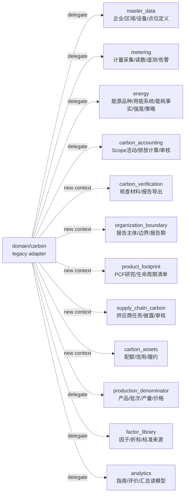
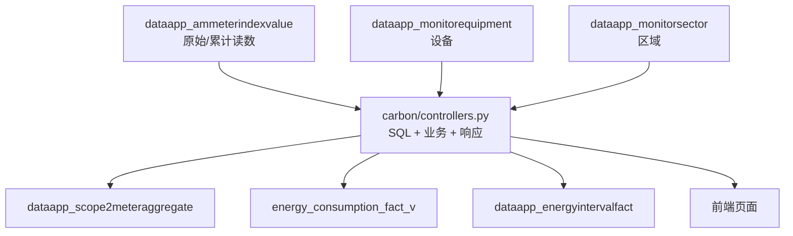
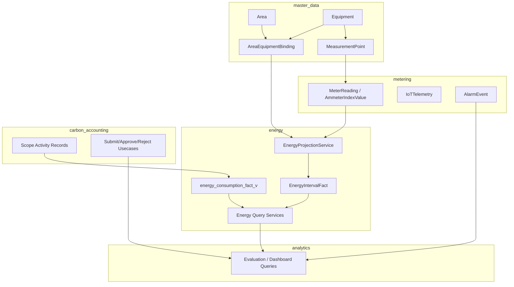

# 现有数据到 DDD 领域映射与改造方案

本文承接 `能碳领域边界DDD设计.md`，把当前 `domain/carbon` 中已有表、接口和数据流映射到改造后的限界上下文，并给出分阶段改造方案。

核心原则：

1. 不先大规模改物理表名，优先拆应用层、查询层和服务职责。
2. 保持旧 API 路径兼容，旧 Controller 逐步变成 legacy adapter。
3. 区域、设备、点位、电表、读数、能源事实、碳核算记录各有归属，不互相污染生命周期。
4. 读模型和投影可以使用 SQL/view，但应进入独立 query service，不继续写在大 Controller 中。
5. 任何新增业务能力优先落到目标领域目录，不再扩大 `domain/carbon/controllers.py`。

## 1. 目标领域总览



## 2. 现有模型到目标领域映射

### 2.1 企业、区域、设备、点位主数据

| 现有模型/表 | 当前位置 | 目标领域 | 目标语义 | 改造动作 |
| --- | --- | --- | --- | --- |
| `EnterpriseInfo` / `dataapp_enterpriseinfo` | `carbon.models` | `master_data` | 企业/园区基本信息、面积分母、组织边界抬头 | 先移动查询/维护接口；物理表名保持。 |
| `MonitorSector` / `dataapp_monitorsector` | `carbon.models` | `master_data` | 区域/园区/车间/楼层树 | 增加区域类型、有效期、历史归属规则；保留旧字段兼容。 |
| `MonitorSectorPhoto` / `dataapp_monitorsectorphoto` | `carbon.models` | `master_data` | 区域附件/照片 | 跟随区域主数据迁移。 |
| `DeviceType` / `dataapp_devicetype` | `carbon.models` | `master_data` | 设备类型字典 | 保持全局字典或按租户配置待定。 |
| `MonitorEquipment` / `dataapp_monitorequipment` | `carbon.models` | `master_data` | 设备/资产主数据 | 明确为资产，不直接保存能耗；后续增加设备状态、投退役时间。 |
| `DevicePoint` / `dataapp_devicepoint` | `carbon.models` | `master_data` + `metering` 交界 | 点位定义：采什么、单位、累计/瞬时属性 | P0 保留在主数据页面；P1 抽象为 `MeasurementPoint`。 |
| `VideoMonitor` / `dataapp_videomonitor` | `carbon.models` | `metering` 或 `safety_monitoring` | 视频监控资产与状态 | 若只服务能碳告警，暂放 `metering`；安全业务扩大后独立。 |
| `ApiResultKeyMapping` / `dataapp_apiresultkeymapping` | `carbon.models` | `metering.infrastructure` | 采集接口字段映射 | 不属于业务主数据，迁到采集适配层。 |

### 2.2 计量、IoT、告警数据

| 现有模型/表 | 当前位置 | 目标领域 | 目标语义 | 改造动作 |
| --- | --- | --- | --- | --- |
| `AmmeterIndexValue` / `dataapp_ammeterindexvalue` | `carbon.models` | `metering` | 电表原始累计读数/采集结果 | 原始数据保留不可覆盖；新增 query service 和投影服务。 |
| `IotTelemetry` / `dataapp_iottelemetry` | `carbon.models` | `metering` | IoT 时序遥测 | 与电表读数并列为时序事实，不直接等于能源消费。 |
| `WarningRule` / `dataapp_warningrule` | `carbon.models` | `metering` | 监测告警规则 | 若规则指向能源异常，输出事件给 energy/analytics。 |
| `AlarmEvent` / `dataapp_alarmevent` | `carbon.models` | `metering` | 设备/能源监测告警事件 | 能源策略只读取，不拥有其生命周期。 |
| `VedioAlarmEvent` / `dataapp_vedioalarmevent` | `carbon.models` | `metering` 或 `safety_monitoring` | 视频告警事件 | 先作为计量/监控告警子类处理。 |

### 2.3 能源管理数据

| 现有模型/表/视图 | 当前位置 | 目标领域 | 目标语义 | 改造动作 |
| --- | --- | --- | --- | --- |
| `EnergyType` / `dataapp_energytype` | `carbon.models` | `energy` | 能源品种、默认 Scope、是否计入综合能耗 | 迁到 energy 字典服务；保留作为折标和 Scope 防串用核心。 |
| `EnergyUnitConversion` / `dataapp_energyunitconversion` | `carbon.models` | `energy` + `factor_library` 交界 | 单位换算、折标煤系数、标准来源 | P0 放 energy；若标准库扩大，系数来源归 `factor_library`。 |
| `EnergyUseSystem` / `dataapp_energyusesystem` | `carbon.models` | `energy` | 用能系统分类，如充电、照明、仓储设施 | 迁到 energy 主数据/字典。 |
| `EnergyUseSystemBinding` / `dataapp_energyusesystembinding` | `carbon.models` | `energy` | 设备/区域到用能系统的时效归类 | 保留置信度、有效期；不作为设备主数据来源。 |
| `EnergyTariffPlan` / `dataapp_energytariffplan` | `carbon.models` | `energy` | 能源价格方案 | 抽命令用例，保证生效期和编码唯一。 |
| `EnergyTariffSegment` / `dataapp_energytariffsegment` | `carbon.models` | `energy` | 峰平谷/尖峰时段价格 | 建立分段不重叠校验。 |
| `EnergyIntervalFact` / `dataapp_energyintervalfact` | `carbon.models` | `energy.infrastructure.projections` | 小时/日能源消费事实 | 明确为读模型/投影，不是原始读数。 |
| `EquipmentWorkloadFact` / `dataapp_equipmentworkloadfact` | `carbon.models` | `energy` + `metering` 交界 | 设备运行小时、作业量事实 | 来源可来自 metering 或 WMS/MES；服务 energy 强度和策略。 |
| `EnergyStorageValue` / `dataapp_energystoragevalue` | `carbon.models` | `energy` | 储能状态/能量值 | 若接入实时储能，应归入 metering 原始遥测 + energy 状态读模型。 |
| `energy_consumption_fact_v` | 数据库视图 | `energy.queries` | 综合能源消费事实视图 | 保留视图；查询 SQL 移到 `EnergyConsumptionQueryService`。 |

### 2.4 碳核算数据

| 现有模型/表 | 当前位置 | 目标领域 | 目标语义 | 改造动作 |
| --- | --- | --- | --- | --- |
| `CarbonAuditBase` | `carbon.models` | `carbon_accounting` | 碳活动记录通用状态流转字段 | 抽象为活动记录基类或 mixin 保留。 |
| `Scope1MobileCombustion` | `carbon.models` | `carbon_accounting` | Scope1 移动源燃料燃烧 | 继续作为碳活动数据；可投影到能源消费事实。 |
| `Scope1StationaryCombustion` | `carbon.models` | `carbon_accounting` | Scope1 固定源燃料燃烧 | 同上。 |
| `Scope1RefrigerantLeak` | `carbon.models` | `carbon_accounting` | Scope1 逸散排放 | 不进入能耗查询。 |
| `Scope2ElectricityBill` | `carbon.models` | `carbon_accounting` + `energy` 交界 | 外购电力账单活动数据 | 能源域可读其消费量；审核流转归碳核算。 |
| `Scope2PurchasedEnergy` | `carbon.models` | `carbon_accounting` + `energy` 交界 | 外购热力/蒸汽/冷量活动数据 | 同上，注意能源品种为 Scope2 外购能源。 |
| `Scope2MeterAggregate` | `carbon.models` | `energy.projections` + `carbon_accounting` 交界 | 电表聚合形成的 Scope2 候选数据 | 重建逻辑迁到 energy projection；提交审核归 carbon。 |
| `Scope3WasteDisposal` | `carbon.models` | `carbon_accounting` | Scope3 废弃物活动数据 | 不进入 P0 能耗查询。 |
| `Scope3ThirdPartyTransport` | `carbon.models` | `carbon_accounting` | Scope3 第三方运输活动数据 | 不进入 P0 能耗查询。 |
| `CarbonAuditLog` | `carbon.models` | `carbon_accounting` | 碳记录审核操作日志 | 跟随碳核算命令用例迁移。 |
| `CarbonAccountingBatch` / `carbon_accounting_batch` | `carbon.models` | `carbon_accounting` | 绑定报告主体、报告期和组织边界版本的一次组织碳核算批次 | 已新建租户表；后续补修订流程和活动记录统一锁定。 |
| `CarbonEmissionInventoryItem` / `carbon_emission_inventory_item` | `carbon.models` | `carbon_accounting` | 组织排放清单快照明细，供核查、碳资产和报告读取 | 已新建租户表；只统计已审核记录并保留质量状态。 |
| `CarbonVerificationExportJob` / `carbon_verification_export_job` | `carbon.models` | `carbon_verification` | 核查报告/材料包导出任务，记录范围、模板、状态、ZIP 文件路径、哈希和导出人 | 已新建租户表；已接入 DOCX/PDF 渲染；后续接异步队列。 |
| `CarbonVerificationExportFile` / `carbon_verification_export_file` | `carbon.models` | `carbon_verification` | 导出包内文件清单，记录 DOCX/PDF、manifest、活动数据、因子参数、问题、审核轨迹等文件 | 已新建租户表；后续接独立附件实体和原件打包。 |

目标新增对象/服务：

| 目标对象/服务 | 目标领域 | 目标语义 | 改造动作 |
| --- | --- | --- | --- |
| `ReportTemplateVersion` | `carbon_verification` | 报告模板版本、标准来源、适用行业、文件路径和启停状态 | 通用模板先配置为 `organization_ghg_generic_v2026_06_13`；行业模板后续按标准/行业新增。 |
| `ReportDocumentRenderer` | `carbon_verification.usecases` | 将 `report_context` 写入 DOCX，转换 PDF，计算哈希并写入导出文件清单 | 已接入导出任务；不放在 Controller；渲染失败应回写导出任务状态和错误信息。 |
| `VerificationAttachment` | `carbon_verification` | 核查材料原件，关联 Scope 活动、清单项、边界设施、因子来源或整改记录 | 替代当前只读取活动记录单一 `attachment` 字段的临时做法。 |
| `CarbonVerificationFinding` / `carbon_verification_finding` | `carbon_verification` | 核查发现生命周期，记录来源问题、关联活动记录、严重等级、状态、整改证据、复核人和关闭时间 | 已新建租户表；由自动问题清单升级为可管理的核查发现生命周期。 |
| `VerificationFinding` | `carbon_verification` | 文件评审、现场核查、不符合项、整改、复核和关闭状态 | 已实现首版；后续与正式核查项目、附件实体和责任人权限联动。 |
| `MaterialPackageAssembler` | `carbon_verification.usecases` | 汇集 DOCX/PDF、数据表、附件原件、问题清单和审核轨迹生成 ZIP | manifest 必须记录文件类型、路径、大小、哈希和来源对象。 |
| `InventorySnapshotReader` | `carbon_verification.queries` | 为核查导出读取已锁定组织排放清单，兼容旧 Scope 活动记录 | 正式报告不再绕过 `organization_boundary` 和 `CarbonAccountingBatch`。 |

### 2.5 生产/产品分母数据

| 现有模型/表 | 当前位置 | 目标领域 | 目标语义 | 改造动作 |
| --- | --- | --- | --- | --- |
| `ProductionProduct` / `dataapp_productionproduct` | `carbon.models` | `production_denominator` | 产品/产出对象主数据 | 页面名称保持“产品”；内部语义支持产品、处理量、作业量。 |
| `ProductPrice` / `dataapp_productprice` | `carbon.models` | `production_denominator` | 产品价格/产值分母台账 | 不放到能源域；energy intensity 只读取其 query API。 |
| `ProductionOutputFact` / `dataapp_productionoutputfact` | `carbon.models` | `production_denominator` | 产品批次产量/处理量/作业量事实 | 作为强度分母，不作为 PCF 核心模型。 |
| `ProductionResourceBinding` / `dataapp_productionresourcebinding` | `carbon.models` | `production_denominator` | 产品与产线/区域/设备的可选关联 | P0 只展示和筛选，不做默认能耗分摊依据。 |
| `InMoney` / `dataapp_inmoney` | `carbon.models` | `production_denominator.infrastructure` | WMS 入库来源数据 | 作为生成产品/批次样本的外部源，不作为目标核心模型。 |
| `OutMoney` / `dataapp_outmoney` | `carbon.models` | `production_denominator.infrastructure` | WMS 出库来源数据 | 同上。 |

### 2.6 因子库与标准数据

| 现有模型/表 | 当前位置 | 目标领域 | 目标语义 | 改造动作 |
| --- | --- | --- | --- | --- |
| `EmissionFactor` / `dataapp_emissionfactor` | `carbon.models` | `factor_library` | 简化排放因子表 | 后续与标准因子库统一查询口径。 |
| `CarbonFactorImportBatch` / `carbon_factor_import_batch` | `carbon.models` | `factor_library` | 因子导入批次 | 迁移导入器和查询接口。 |
| `CarbonFactorLibrary` / `carbon_factor_library` | `carbon.models` | `factor_library` | 因子来源库 | 作为标准/来源根对象。 |
| `CarbonFactorCategory` / `carbon_factor_category` | `carbon.models` | `factor_library` | 因子分类树 | 保留。 |
| `CarbonFactorRawRecord` / `carbon_factor_raw_record` | `carbon.models` | `factor_library` | 原始因子记录 | 保留不可丢，用于追溯。 |

### 2.7 分析和展示数据

| 现有代码/接口 | 当前位置 | 目标领域 | 目标语义 | 改造动作 |
| --- | --- | --- | --- | --- |
| `CarbonDashboardController` | `carbon.controllers` | `analytics` 或 legacy bigscreen | 老大屏/历史页面查询 | 保持兼容；不再新增业务。 |
| `CarbonAnalyticsController` | `carbon.controllers` | `analytics` | 旧碳/能流分析聚合 | 拆为 analytics query service。 |
| `EnergyCarbonCenterController` | `carbon.controllers` | `analytics` | 能碳中心汇总旧接口 | 只消费各领域查询，不直接做业务计算。 |
| `BigscreenController` / `HuayiBigscreenController` | `carbon.routes` | `analytics.bigscreen` | 大屏展示 API | 与业务办理分离。 |

### 2.8 高阶碳管理新增领域映射

这些领域当前没有稳定的目标表，不能继续用现有产品分母、Scope 活动或能碳预算表临时冒充。首批应新建租户表，并只引用已有事实。

| 新领域 | 可复用现有模型/读模型 | 不可复用为核心模型 | 目标语义 | 改造动作 |
| --- | --- | --- | --- | --- |
| `organization_boundary` | `EnterpriseInfo`、`MonitorSector`、`MonitorEquipment`、`team_id` | `EnterpriseInfo` 不能直接等同于报告边界 | 报告主体、报告期、组织/运营边界、边界设施、版本 | 首版已新建报告主体、报告期、边界版本和边界设施表；碳核算批次后续必须绑定边界版本。 |
| `product_footprint` | `ProductionProduct`、`ProductionOutputFact`、`ProductionResourceBinding`、`EnergyIntervalFact`、`EmissionFactor` | `ProductionProduct`、`ProductionOutputFact` 不能冒充 PCF 研究和生命周期清单 | PCF 研究、产品系统、生命周期阶段、清单项、分配规则、结果和报告 | 2026-06-13 已新增 PCF 聚合表和 `domain/product_footprint` 首版；已有产品/产量/能源事实仍只作为输入。 |
| `supply_chain_carbon` | `Scope3ThirdPartyTransport`、`Scope3WasteDisposal`、`InMoney`、`OutMoney`、产品和供应商相关外部数据 | 运输/废弃物 Scope3 表不能冒充供应商协同任务 | 供应商档案、填报任务、供应商活动数据、PCF 数据、证据、审核、披露 | 2026-06-13 已新增供应链碳聚合表和 `domain/supply_chain_carbon` 首版；审核通过后再通过显式发布/转换用例供 Scope3 或 PCF 使用。 |
| `carbon_assets` | `carbon_accounting` 组织排放清单批次、组织边界版本、资产账户和持仓台账 | `EnergyCarbonBudgetPlan` 不能冒充配额；Scope 活动不能冒充资产持仓 | 履约周期、配额账户、CCER/绿证、交易、清缴、履约缺口 | 2026-06-13 已新增履约周期、资产账户、配额、信用/绿证、交易模拟和清缴表；缺口读模型只读取组织清单批次和资产余额。 |

## 3. 现有接口到目标领域映射

| 现有 API 前缀 | 当前 Controller | 目标领域 | 改造方式 |
| --- | --- | --- | --- |
| `/api/master-data/areas*` | `CarbonCRUDController` | `master_data.controllers.areas` | 拆 Controller，复用旧表和服务。 |
| `/api/master-data/devices*` | `CarbonCRUDController` | `master_data.controllers.devices` | 拆 Controller，后续补设备时效字段。 |
| `/api/master-data/device-points*` | `CarbonCRUDController` | `master_data.controllers.points`，P1 到 `metering` | 先作为点位定义管理，后续重命名概念为 MeasurementPoint。 |
| `/api/data/ammeter-values` | `CarbonCRUDController` | `metering.controllers.readings` | 只读原始读数查询。 |
| `/api/data/alarm-events*` | `CarbonCRUDController` | `metering.controllers.alarms` | 告警处理命令迁到 metering usecases。 |
| `/api/carbon/scope*` | `CarbonCRUDController` | `carbon_accounting.controllers.scope_records` | 旧路径兼容，新 Controller 承载业务。 |
| `/api/carbon/scope2-meter-aggregate*` | `CarbonCRUDController` | `energy.usecases.rebuild_meter_aggregates` + `carbon_accounting` 审核 | 重建归 energy，提交/审核归 carbon。 |
| `/api/carbon/accounting/batches*` | `CarbonAccountingInventoryController` | `carbon_accounting.controllers` | 已新增核算批次创建、重建清单、锁定和摘要 API。 |
| `/api/carbon/accounting/inventories*` | `CarbonAccountingInventoryController` | `carbon_accounting.controllers` | 已新增组织排放清单快照查询 API。 |
| `/api/carbon/factor-library*` | `CarbonCRUDController` | `factor_library.controllers` | 抽因子库查询和详情。 |
| `/api/carbon/organization-boundary/*` | `OrganizationBoundaryController` | `organization_boundary.controllers` | 已新增报告主体、报告期、边界版本、边界设施、发布和汇总 API。 |
| `/api/carbon/verification/*` | `CarbonVerificationController` | `carbon_verification.controllers` | 已新增读模型和导出任务；读取核算事实和审核日志，不反写 Scope 记录。 |
| `/api/energy/types` | `CarbonCRUDController` | `energy.controllers.energy_types` | 能源字典。 |
| `/api/energy/unit-conversions` | `CarbonCRUDController` | `energy.controllers.conversions` | 折标/单位换算。 |
| `/api/energy/consumption/*` | `CarbonCRUDController` | `energy.controllers.consumption` + `energy.queries.consumption` | 查询服务化。 |
| `/api/energy/intensity/*` | `CarbonCRUDController` | `energy.controllers.intensity` + `energy.queries.intensity` | 查询服务化；生产分母通过 `production_denominator` query service。 |
| `/api/energy/analysis/*` | `CarbonCRUDController` | `energy.controllers.analysis` + `energy.queries.analysis` | 查询服务化；策略先规则型。 |
| `/api/production/*` | `CarbonCRUDController` | `production_denominator.controllers` | 产品、价格、批次、关联台账整体迁移。 |
| `/api/energy-carbon/*` | `EnergyCarbonCenterController` | `analytics.controllers.energy_carbon_center` | 汇总页只调用领域 query service。 |
| `/api/page*`、`/api/map*` | `CarbonDashboardController` 等 | legacy 或 `analytics.bigscreen` | 保持兼容，逐步下线或改为大屏专用。 |

## 4. 数据流改造前后对照

### 4.1 当前数据流



问题：Controller 同时承担原始读数解释、设备区域归属、能源投影、Scope2 聚合、页面查询和响应组装。

### 4.2 目标数据流



目标：原始读数解释在 `metering`，能源事实投影在 `energy`，碳审核在 `carbon_accounting`，页面汇总在 `analytics`。

## 5. 改造阶段

### Phase 0：冻结边界，禁止继续扩大 `carbon`

目标：从流程上止血。

- 新增文档已完成：
  - `能碳领域边界DDD设计.md`
  - 本文档
- 约束新增接口：
  - 新能源接口进 `domain/energy`
  - 新产品/分母接口进 `domain/production_denominator`
  - 新主数据接口进 `domain/master_data`
  - 新计量接口进 `domain/metering`
- `domain/carbon/controllers.py` 只允许 bugfix 和兼容委托，不再承载新业务查询。

验收：

- 新开发方案必须说明目标领域。
- PR/提交说明中必须说明是否新增表、是否改变领域边界。

### Phase 1：抽查询服务，不改 API

目标：降低大 Controller 的复杂度，不破坏前端。

优先抽：

| 查询服务 | 来源接口 | 目标文件 |
| --- | --- | --- |
| `EnergyConsumptionQueryService` | `/api/energy/consumption/facts`、`/summary`、`/export` | `domain/energy/queries/consumption.py` |
| `EnergyIntensityQueryService` | `/api/energy/intensity/*` | `domain/energy/queries/intensity.py` |
| `EnergyAnalysisQueryService` | `/api/energy/analysis/*` | `domain/energy/queries/analysis.py` |
| `ProductionDenominatorQueryService` | `/api/production/output/summary`、产品/产值强度 | `domain/production_denominator/queries.py` |
| `MasterDataQueryService` | `/api/master-data/*` 树和摘要 | `domain/master_data/queries.py` |

改造模式：

```python
class CarbonCRUDController(Controller):
    @get("/api/energy/analysis/summary")
    async def get_energy_analysis_summary(...):
        query = EnergyAnalysisQuery.from_http(...)
        data = await EnergyAnalysisQueryService(db_session).summary(query)
        return Response({"code": 200, "msg": "获取成功", "data": data})
```

验收：

- 旧 API 响应结构不变。
- 前端无需改接口路径。
- Controller 中 raw SQL 行数明显下降。

### Phase 2：抽命令用例，统一状态流转

目标：提交、审核、驳回、重建、导入这类动作从 Controller 迁到 usecase。

优先抽：

| 用例 | 目标领域 | 说明 |
| --- | --- | --- |
| `SubmitCarbonActivityRecord` | `carbon_accounting` | 统一 Scope1/2/3 提交流转。 |
| `ApproveCarbonActivityRecord` | `carbon_accounting` | 写审核状态和审计日志。 |
| `RejectCarbonActivityRecord` | `carbon_accounting` | 写驳回理由和审计日志。 |
| `RebuildScope2MeterAggregate` | `energy` + `carbon_accounting` | 从电表事实生成 Scope2 候选记录。 |
| `SeedProductionDenominatorData` | `production_denominator` | WMS 入出库生成产品、批次、价格样本。 |
| `SeedEnergyAnalysisFacts` | `energy` | 电表读数生成小时/日用能事实和运行小时。 |

验收：

- 状态流转规则只在 usecase 中维护。
- 审计日志统一由碳核算用例写入。
- Controller 只做参数解析和错误映射。

### Phase 3：拆 Controller 和路由注册

目标：物理目录表达领域边界。

建议顺序：

1. `domain/energy/controllers/`
   - `energy_types.py`
   - `consumption.py`
   - `intensity.py`
   - `analysis.py`
2. `domain/production_denominator/controllers/`
   - `products.py`
   - `prices.py`
   - `output_facts.py`
   - `resource_bindings.py`
3. `domain/master_data/controllers/`
   - `areas.py`
   - `devices.py`
   - `points.py`
4. `domain/carbon_accounting/controllers/`
   - `scope1.py`
   - `scope2.py`
   - `scope3.py`
   - `audit.py`
5. `domain/metering/controllers/`
   - `readings.py`
   - `telemetry.py`
   - `alarms.py`

验收：

- `domain/carbon/controllers.py` 只保留 legacy bigscreen/兼容入口，或拆空。
- 每个新 Controller 文件只处理一个业务能力。

### Phase 4：补数据模型和投影能力

目标：把当前“隐含关系”补成可追溯模型。

新增或增强：

| 模型 | 目标领域 | 原因 |
| --- | --- | --- |
| `AreaEquipmentBinding` | `master_data` | 区域-设备关系需要有效期，不能只看当前 `sector_id`。 |
| `MeasurementPoint` 语义增强 | `metering` | `DevicePoint` 需要明确累计/瞬时、单位、指标类型。 |
| `MeterReadingCorrection` | `metering` | 原始读数补录/修正不能覆盖历史。 |
| `EnergyProjectionRun` | `energy` | 记录能源事实投影任务、条件、版本和错误。 |
| `EnergyFactQualityIssue` | `energy` | 记录负增量、缺口、单位异常、归属缺失。 |
| `EnergyProductionAllocationFact` | `energy` | P1/P2 支持产品/区域/设备能耗分摊。 |

验收：

- 历史区域归属可追溯。
- 电表读数修正后可重放投影。
- 能源事实能解释来源和质量。

## 6. 字段级映射重点

### 6.1 `MonitorEquipment` 到 `Equipment`

| 当前字段 | 目标字段 | 说明 |
| --- | --- | --- |
| `id` | `equipment_id` | 保持主键。 |
| `code` | `code` | 租户内唯一。 |
| `name` | `name` | 设备名称。 |
| `sector_id` | `AreaEquipmentBinding.area_id` | 当前字段作为现时关系，后续迁到时效绑定表。 |
| `device_type_id` | `equipment_type_id` | 设备类型。 |
| `status` | `status` | 设备状态。 |
| `energy_type` | 不建议直接使用 | 当前多数为空；能源品种应由点位/电表/用能系统映射决定。 |

### 6.2 `DevicePoint` 到 `MeasurementPoint`

| 当前字段 | 目标字段 | 说明 |
| --- | --- | --- |
| `id` | `point_id` | 点位标识。 |
| `equipment_id` | `equipment_id` | 所属设备/计量资产。 |
| `code`/`name` | `code`/`name` | 点位编码和名称。 |
| `unit` | `unit` | 采集单位。 |
| 现缺 | `metric_type` | 如 active_energy、power、run_status、temperature、workload。 |
| 现缺 | `is_cumulative` | 区分累计读数和瞬时值。 |
| 现缺 | `energy_type_code` | 只对能源类点位维护。 |
| 现缺 | `quality_rule` | 负增量、跳变、缺测规则。 |

### 6.3 `AmmeterIndexValue` 到 `MeterReading`

| 当前字段 | 目标字段 | 说明 |
| --- | --- | --- |
| `id` | `source_record_id` | 投影来源记录。 |
| `equipment_id` | `meter_id` 或 `equipment_id` | 当前用设备表示电表，需要语义上识别为计量资产。 |
| `created_at`/采集时间字段 | `observed_at` | 必须明确采集时间，不能只用写入时间。 |
| `zygdnsz` | `reading_value` | 当前用于有功电能累计值。 |
| `zygdnsz` 的差值 | `delta_value` | 投影时生成，不覆盖原始值。 |
| `area_id` | 投影归属辅助 | 后续优先从时效绑定表追溯。 |

### 6.4 `EnergyIntervalFact`

| 当前字段 | 目标语义 | 注意 |
| --- | --- | --- |
| `source_system` | 投影来源，如 meter_hourly、meter_daily | 用于重放和删除本来源投影。 |
| `source_record_id` | 投影唯一来源 | 小时事实可用 equipment + hour。 |
| `energy_type_code` | 能源品种 | P0 电表为 purchased_electricity。 |
| `amount`/`unit` | 区间用量 | 不能存原始累计值。 |
| `area_id/name` | 发生时归属区域 | 冗余字段，来源是 master_data。 |
| `equipment_id/name` | 发生时设备/电表 | 冗余字段，来源是 master_data/metering。 |
| `use_system_code/name` | 用能系统归类 | 来源是 energy 的绑定规则。 |
| `tariff_segment_type` | 峰平谷 | 来源是 EnergyTariffPlan。 |
| `data_quality` | 数据质量 | 应标注 measured/estimated/corrected/incomplete。 |

## 7. 风险和保护措施

| 风险 | 影响 | 保护措施 |
| --- | --- | --- |
| 表名不改但目录拆分后开发者找不到模型 | 开发效率下降 | `app.db.models` 继续统一 re-export；领域服务只引用所需模型。 |
| 区域关系改成时效后历史统计变化 | 报表口径变化 | 新增绑定表时先只记录新关系；旧事实保留冗余区域名称。 |
| 点位语义增强影响采集适配器 | 数据接入中断 | `DevicePoint` 先兼容旧字段，新增字段默认可空，逐步补齐。 |
| 能源事实重建导致强度数据变化 | 页面数值波动 | 引入 `EnergyProjectionRun` 记录投影批次，可比对前后结果。 |
| Scope2 电表聚合和能源事实重复计算 | 电力重复计量 | 明确 `EnergyIntervalFact` 是能源分析事实，`Scope2MeterAggregate` 是碳核算候选记录。 |
| 产品资源关联被误用为精确分摊 | 产品强度失真 | P0 页面标记为筛选/覆盖，不默认做设备级产品强度。 |
| 旧 Controller 与新 Controller 路径冲突 | 路由错误 | 先保持旧路径委托，不同时注册同一路径的新旧 handler。 |

## 8. 推荐实施顺序

1. 建立目标包目录和空的 `__init__.py`，不移动表。
2. 抽 `energy.queries.analysis`，把 `/api/energy/analysis/*` 的 SQL 移出 Controller。
3. 抽 `energy.queries.consumption` 和 `energy.queries.intensity`。
4. 抽 `production_denominator.queries`，让强度页通过生产分母 query service 获取产品/产值数据。
5. 抽 `master_data.queries`，统一区域树、设备树、点位查询。
6. 抽 `carbon_accounting.usecases`，统一 Scope 提交/审核/驳回。
7. 抽 `metering.queries` 和 `metering.projections`，规范电表读数与能源事实投影。
8. 最后拆路由文件，保持 API 路径不变。

## 9. 第一批可执行任务

| 优先级 | 任务 | 产物 | 验收 |
| --- | --- | --- | --- |
| P0 | 新建领域包目录 | `domain/energy`、`domain/master_data`、`domain/metering` 等 | 不影响现有测试和导入。 |
| P0 | 抽能源分析查询服务 | `EnergyAnalysisQueryService` | `/api/energy/analysis/*` 响应不变。 |
| P0 | 抽能源分析投影生成用例 | `SeedEnergyAnalysisFacts` | CLI 仍可生成小时/日事实。 |
| P0 | 抽生产分母查询服务 | `ProductionDenominatorQueryService` | 产品强度/产值强度响应不变。 |
| P1 | 抽区域/设备查询服务 | `MasterDataQueryService` | 区域设备树和主数据页面响应不变。 |
| P1 | 设计 `AreaEquipmentBinding` 迁移 | Alembic migration 草案 | 可从现有 `sector_id` 回填当前绑定。 |
| P1 | 增强 `DevicePoint` 点位语义 | 字段迁移草案 | 能标识累计/瞬时、指标类型、能源品种。 |
| P2 | 投影任务批次和质量问题 | `EnergyProjectionRun`、`EnergyFactQualityIssue` | 重建可审计，异常可追溯。 |
