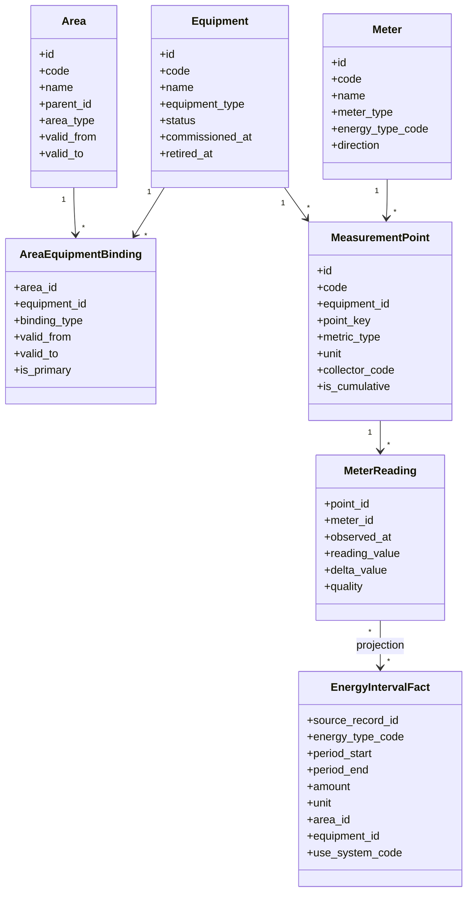
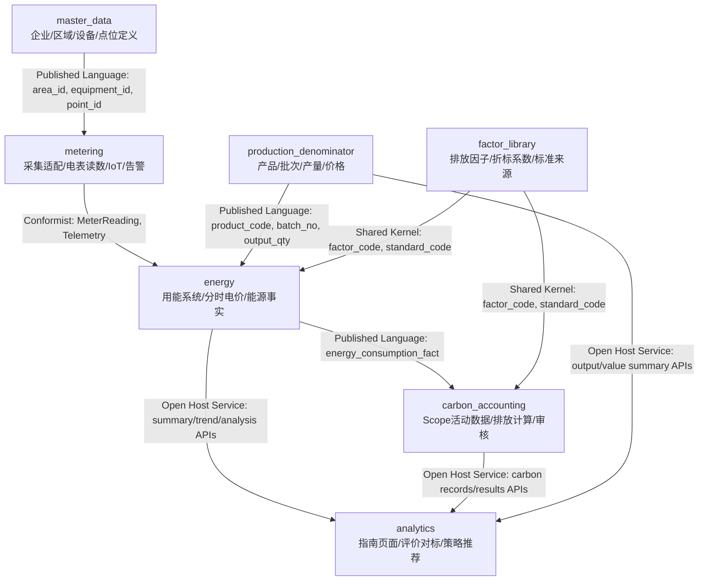
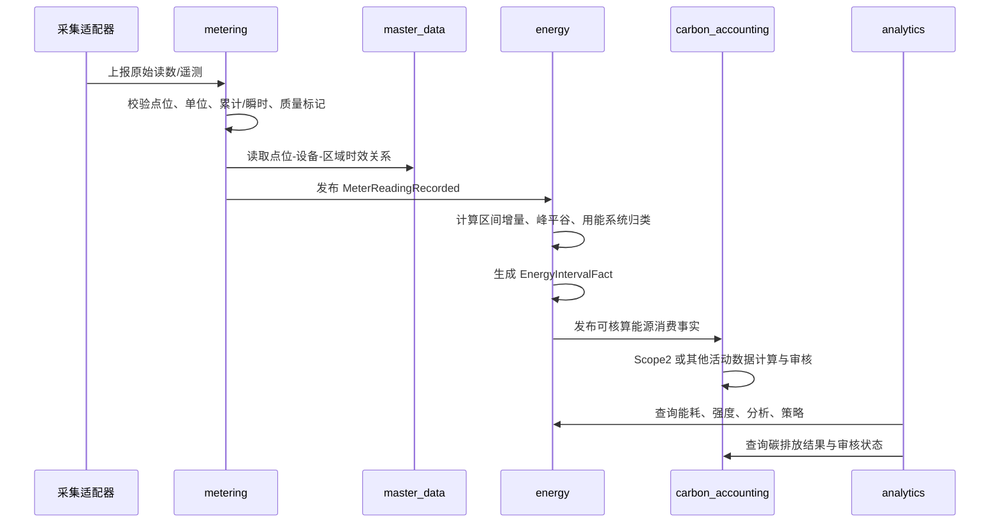
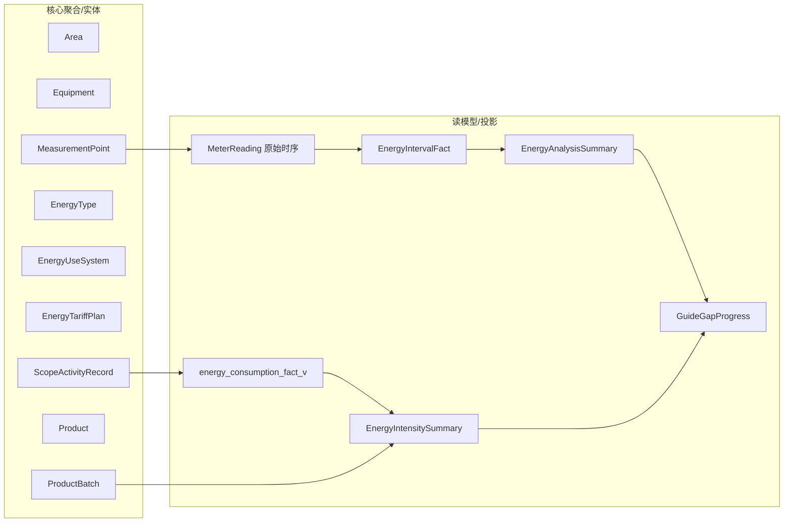

# 能碳领域边界 DDD 设计

本文先用领域建模图明确边界，避免后续把区域、设备、点位、IoT、电表读数、能源消费事实和碳核算活动数据混成一个大模型。

当前结论：`carbon` 包应逐步降级为 legacy adapter。新增能力按 `master_data`、`metering`、`energy`、`carbon_accounting`、`production_denominator`、`factor_library`、`analytics` 等限界上下文组织。数据库表名可暂时保持不变，先收敛应用层和查询层边界。

## 1. 限界上下文图

```mermaid
flowchart LR
    subgraph MD["master_data 企业/空间/资产主数据"]
        Enterprise["Enterprise 企业"]
        Area["Area 区域/园区/车间"]
        Equipment["Equipment 设备/资产"]
        DevicePoint["DevicePoint 测点定义"]
        AreaBinding["AreaEquipmentBinding 区域-设备时效关联"]
    end

    subgraph MTR["metering 计量与采集"]
        Meter["Meter 计量设备/电表"]
        Point["MeasurementPoint 采集点位"]
        Reading["MeterReading 原始读数"]
        Telemetry["IoTTelemetry 时序遥测"]
        Alarm["MonitoringAlarm 监测告警"]
    end

    subgraph ENG["energy 能源管理"]
        EnergyType["EnergyType 能源品种"]
        UseSystem["EnergyUseSystem 用能系统"]
        Tariff["EnergyTariffPlan 分时电价"]
        IntervalFact["EnergyIntervalFact 小时/日用能事实"]
        ConsumptionFact["EnergyConsumptionFact 综合能耗事实/视图"]
        Strategy["EnergyStrategy 策略建议读模型"]
    end

    subgraph CA["carbon_accounting 碳核算"]
        ScopeRecord["ScopeActivityRecord Scope活动数据"]
        CarbonCalc["CarbonCalculation 排放计算"]
        Audit["CarbonAudit 审核流转"]
    end

    subgraph PD["production_denominator 生产/经营分母"]
        Product["Product 产品"]
        Batch["ProductBatch 产品批次/产量"]
        Price["ProductPrice 产品价格"]
        ResourceLink["ProductResourceBinding 产品产线/区域关联"]
    end

    subgraph FL["factor_library 因子与标准"]
        EmissionFactor["EmissionFactor 排放因子"]
        Conversion["EnergyConversion 折标/单位换算"]
        Standard["StandardSource 标准来源"]
    end

    subgraph AN["analytics 评价/汇总读模型"]
        GuidePage["GuidePageQuery 指南页面查询"]
        Roadmap["EvaluationGap 对标进度"]
    end

    MD --> MTR
    MTR --> ENG
    FL --> ENG
    FL --> CA
    ENG --> CA
    PD --> ENG
    ENG --> AN
    CA --> AN
    PD --> AN
```



### 边界原则

| 概念 | 所属上下文 | 说明 |
| --- | --- | --- |
| 企业、区域、设备、设备类型 | `master_data` | 描述组织边界、空间边界和资产，不保存时序读数和能源计算结果。 |
| 点位定义 | `master_data` 或 `metering` 的交界 | 设备有哪些可采集点属于主数据；点位实时值、历史值属于 `metering`。 |
| 电表 | `metering` | 电表是计量设备，不等同于用能设备。电表可挂接区域、设备、用能系统，但不拥有区域/设备生命周期。 |
| IoT 遥测 | `metering` | 原始时序数据，只表达采集事实，不直接等于能源消费事实。 |
| 告警 | `metering` | 监测告警来源于采集或规则，后续可被能源策略引用，但不是能源事实本身。 |
| 能源品种、折标、用能系统 | `energy` | 能源管理的核心字典和分类。 |
| 小时/日用能事实 | `energy` | 从原始读数投影得到的能源分析事实，允许冗余设备/区域名称用于查询。 |
| Scope1/2/3 活动数据 | `carbon_accounting` | 碳核算业务记录，可引用能源消费事实或能源品种，但不应承载计量采集规则。 |
| 产品、批次、产量、价格 | `production_denominator` | 用于强度分母和后续 PCF 输入之一，不属于能源或碳核算核心表。 |
| 指南页面汇总 | `analytics` | 只消费各领域 query service，不直接拥有业务事实。 |

## 2. 关键边界：区域、设备、点位、电表

这里建议使用“资产/空间主数据 + 计量点位 + 能源投影”的三层结构。



### 设计决策

1. `Area` 不直接保存能耗。区域能耗来自计量或能源事实按区域聚合。
2. `Equipment` 不直接保存电量。设备电量来自点位、电表、用能事实。
3. `MeasurementPoint` 表达“采什么”，`MeterReading` 表达“采到了什么”。
4. 电表不等于设备。电表是计量资产，可被安装在设备、回路、区域或总进线。
5. 区域-设备关系必须有时效。历史能耗追溯时，应按发生时间归属当时区域。
6. `EnergyIntervalFact` 可以冗余 `area_name`、`equipment_name`，但它是投影冗余，不是主数据来源。

## 3. 上下文映射图



### 映射关系说明

| 来源 | 目标 | 关系类型 | 规则 |
| --- | --- | --- | --- |
| `master_data` | `metering` | Published Language | 只发布稳定标识和时效关系，不让采集域修改区域/设备主数据。 |
| `metering` | `energy` | Conformist + Projection | 能源域服从计量域的原始读数格式，但通过投影生成业务可查询的能源事实。 |
| `factor_library` | `energy` / `carbon_accounting` | Shared Kernel | 标准、折标、排放因子需要统一字典，不能各域各写一套系数。 |
| `energy` | `carbon_accounting` | Published Language | Scope2 电力、外购热力等可引用能源事实，但碳审核流转由碳核算域负责。 |
| `production_denominator` | `energy` | Published Language | 产品产量/产值作为强度分母输入，不让能源域拥有产品生命周期。 |
| 各业务域 | `analytics` | Open Host Service | 页面汇总和策略推荐只能消费 query API，不直接写业务事实。 |

## 4. 计量到能源事实的数据流



### 投影规则

1. 原始读数不可覆盖，修正应生成补录/修正记录或质量状态。
2. 累计读数转区间用量属于 `metering -> energy` 投影，不属于主数据。
3. 峰平谷成本归属属于 `energy`，因为它依赖能源价格方案。
4. 用能系统归类属于 `energy`，但设备和区域名称来自 `master_data`。
5. 碳排放计算使用能源事实或碳活动表，不反向修改能源事实。

## 5. 聚合与读模型划分



### 聚合建议

| 上下文 | 聚合/实体 | 关键不变量 |
| --- | --- | --- |
| `master_data` | `Area` | 区域树不能成环；编码在租户内唯一；历史记录不能破坏追溯。 |
| `master_data` | `Equipment` | 设备编码在租户内唯一；设备状态和退役时间影响新采集绑定。 |
| `metering` | `MeasurementPoint` | 点位编码唯一；单位、累计/瞬时属性决定读数解释方式。 |
| `metering` | `MeterReading` | 同一点位同一采集时间去重；质量状态不可丢；原始值不可随意覆盖。 |
| `energy` | `EnergyType` | 能源品种、默认 Scope、折标口径不能互相串用。 |
| `energy` | `EnergyTariffPlan` | 同一方案分时段不能重叠；生效期不能冲突。 |
| `energy` | `EnergyUseSystem` | 用能系统分类稳定；设备归类要有时效和置信度。 |
| `carbon_accounting` | `ScopeActivityRecord` | 提交/审核/驳回状态流转必须受控；计算因子来源可追溯。 |
| `production_denominator` | `ProductBatch` | 产品、批次、时间、产量、单位和质量状态可追溯。 |

## 6. 模块落位建议

首阶段只拆应用层和查询层，不改物理表名。

```text
src/py/app/domain/
├── master_data/
│   ├── controllers/
│   ├── services/
│   └── queries.py
├── metering/
│   ├── collectors/
│   ├── services/
│   ├── queries.py
│   └── projections.py
├── energy/
│   ├── controllers/
│   ├── services/
│   ├── queries/
│   │   ├── consumption.py
│   │   ├── intensity.py
│   │   └── analysis.py
│   ├── usecases/
│   │   ├── seed_analysis_facts.py
│   │   └── rebuild_interval_facts.py
│   └── domain/
│       ├── value_objects.py
│       └── policies.py
├── carbon_accounting/
│   ├── controllers/
│   ├── services/
│   ├── usecases/
│   └── calculators.py
├── production_denominator/
│   ├── controllers/
│   ├── services/
│   └── queries.py
├── factor_library/
│   ├── controllers/
│   ├── services/
│   └── importers.py
└── analytics/
    ├── controllers/
    └── queries.py
```

### 从现状迁移的第一批目标

| 当前位置 | 目标位置 | 类型 |
| --- | --- | --- |
| `/api/energy/consumption/*` | `domain/energy/controllers/consumption.py` + `domain/energy/queries/consumption.py` | 读模型查询 |
| `/api/energy/intensity/*` | `domain/energy/controllers/intensity.py` + `domain/energy/queries/intensity.py` | 读模型查询 |
| `/api/energy/analysis/*` | `domain/energy/controllers/analysis.py` + `domain/energy/queries/analysis.py` | 读模型查询 |
| `energy_analysis_importer.py` | `domain/energy/usecases/seed_analysis_facts.py` 或 `infrastructure/projections.py` | 投影生成 |
| `/api/production/*` | `domain/production_denominator/controllers/` | 分母台账 |
| `/api/master-data/*` | `domain/master_data/controllers/` | 主数据 |
| Scope 提交/审核/驳回 | `domain/carbon_accounting/usecases/` | 命令用例 |

## 7. 需要特别避免的设计错误

1. 不要让 `Area` 直接拥有电量字段。
2. 不要让 `Equipment` 直接拥有碳排放字段。
3. 不要把电表读数直接当成企业综合能耗；必须经过点位解释、增量计算、质量校验、区域/设备归属和能源品种映射。
4. 不要把点位定义和点位读数混在一张业务表里。
5. 不要把 Scope2 电力账单、电表聚合、能源事实、碳排结果视为同一个概念。
6. 不要用当前区域关系覆盖历史归属；历史查询必须按事实发生时间追溯。
7. 不要让 `analytics` 页面直接改业务事实。
8. 不要让产品/产量台账成为产品碳足迹核心模型；它只是强度分母和 PCF 的一个输入来源。

## 8. P0 到优秀版的演进关系

| 能力 | P0 做法 | 向优秀版演进 |
| --- | --- | --- |
| 三级统计 | 以企业、区域、设备树查询能源事实 | 区域/设备关系增加时效、覆盖率和历史版本 |
| 日/月/年维度 | 事实表按小时/日投影，查询层聚合到日/月/年 | 增加分钟级事实和压测验收 |
| 峰平谷 | 用分时电价方案给小时事实打标签 | 支持企业自定义电价、尖峰段、季节电价 |
| 设备运行时间 | 先由有功增量小时数推导运行小时 | 接入设备状态点位、作业量点位、MES/WMS 作业量 |
| 策略推荐 | 规则型策略基于用能系统、峰平谷、异常 | 引入基线模型、节能诊断闭环和效果验证 |
| 碳核算联动 | 能源事实可供 Scope2/强度计算引用 | 能源事实、账单、碳排结果三方核对 |

