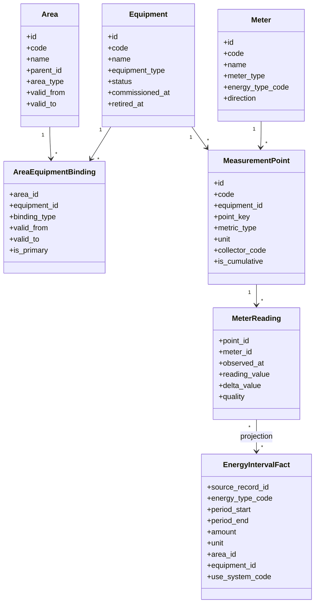
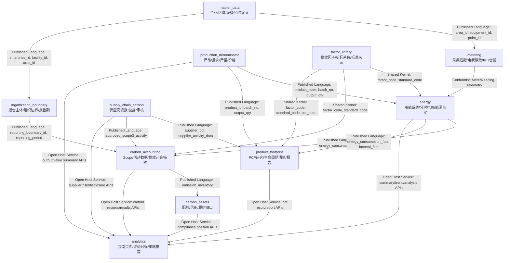
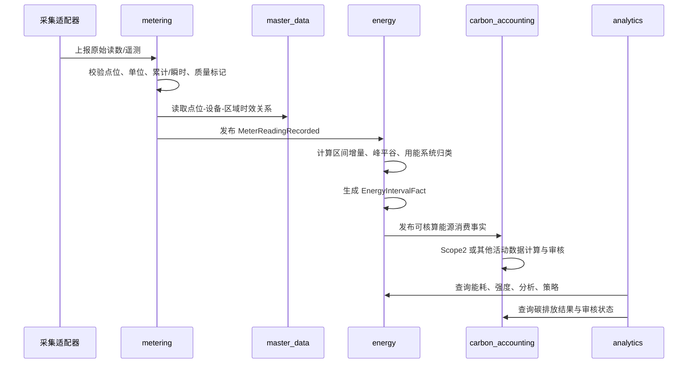
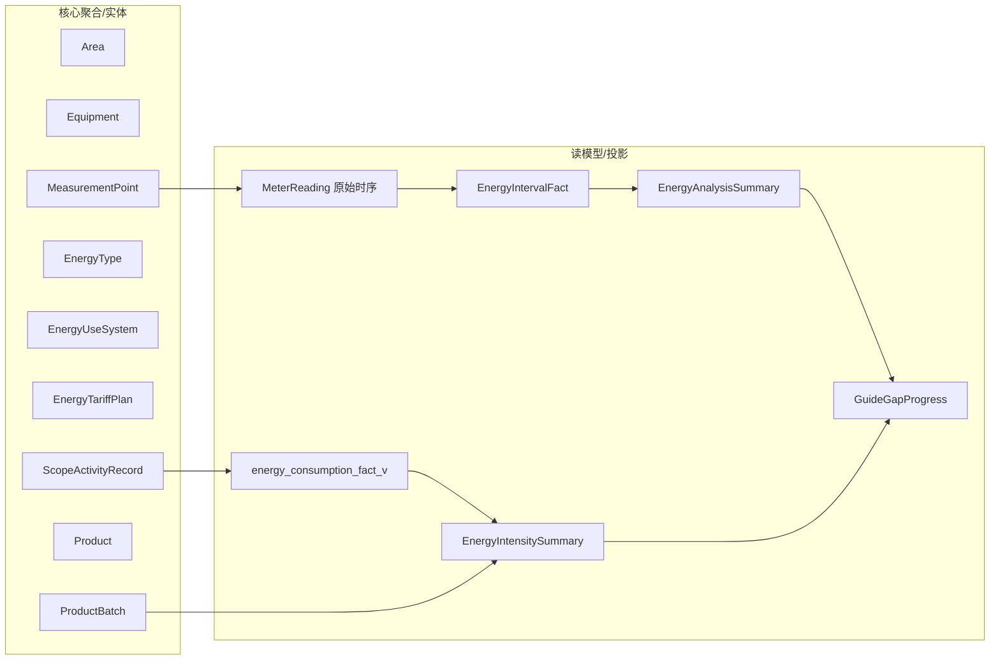
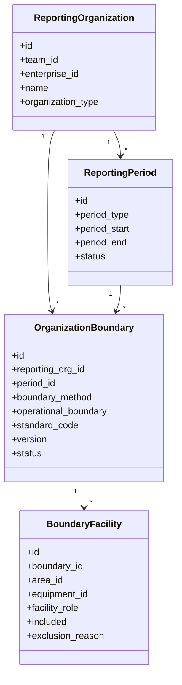
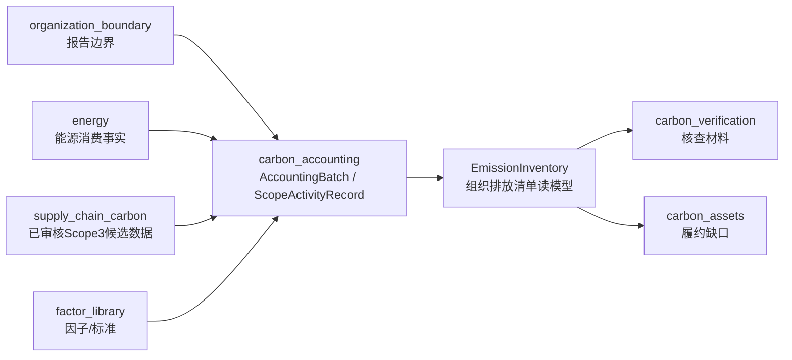
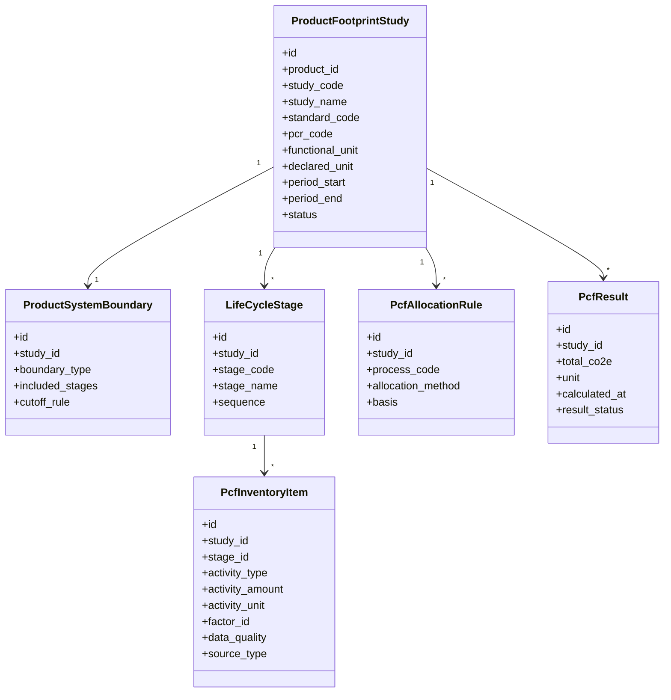
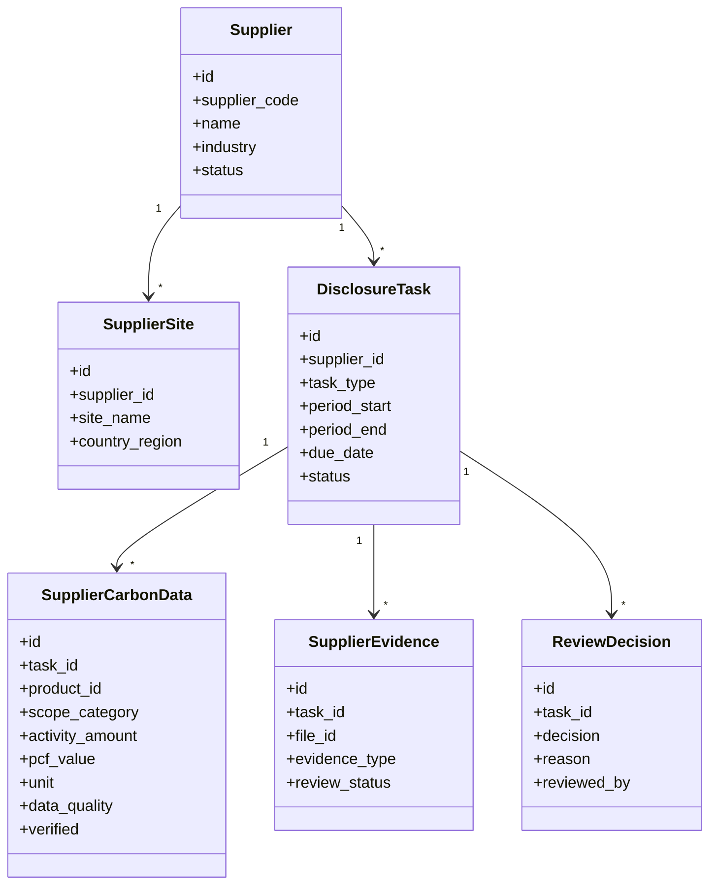
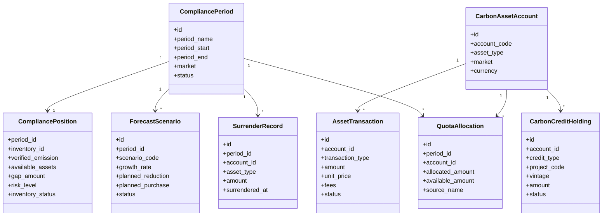

# 能碳领域边界 DDD 设计

本文先用领域建模图明确边界，避免后续把区域、设备、点位、IoT、电表读数、能源消费事实、碳核算活动数据、产品碳足迹、供应链披露和碳资产配额混成一个大模型。

当前结论：`carbon` 包应逐步降级为 legacy adapter。新增能力按 `master_data`、`metering`、`energy`、`carbon_accounting`、`carbon_verification`、`production_denominator`、`factor_library`、`analytics`、`organization_boundary`、`product_footprint`、`supply_chain_carbon`、`carbon_assets` 等限界上下文组织。数据库表名可暂时保持不变，先收敛应用层和查询层边界。

## 1. 限界上下文图

```mermaid
flowchart LR
    subgraph MD["master_data 企业/空间/资产主数据"]
        Enterprise["Enterprise 企业"]
        Area["Area 区域/园区/车间"]
        Equipment["Equipment 设备/资产"]
        DevicePoint["DevicePoint 测点定义"]
        AreaBinding["AreaEquipmentBinding 区域-设备时效关联"]
    end

    subgraph MTR["metering 计量与采集"]
        Meter["Meter 计量设备/电表"]
        Point["MeasurementPoint 采集点位"]
        Reading["MeterReading 原始读数"]
        Telemetry["IoTTelemetry 时序遥测"]
        Alarm["MonitoringAlarm 监测告警"]
    end

    subgraph ENG["energy 能源管理"]
        EnergyType["EnergyType 能源品种"]
        UseSystem["EnergyUseSystem 用能系统"]
        Tariff["EnergyTariffPlan 分时电价"]
        IntervalFact["EnergyIntervalFact 小时/日用能事实"]
        ConsumptionFact["EnergyConsumptionFact 综合能耗事实/视图"]
        Strategy["EnergyStrategy 策略建议读模型"]
    end

    subgraph CA["carbon_accounting 碳核算"]
        ScopeRecord["ScopeActivityRecord Scope活动数据"]
        CarbonCalc["CarbonCalculation 排放计算"]
        Audit["CarbonAudit 审核流转"]
    end

    subgraph CV["carbon_verification 碳核查支撑"]
        Evidence["EvidenceManifest 凭证清单"]
        MaterialPackage["VerificationPackage 核查材料包"]
        ReportContext["ReportContext 报告上下文"]
        VerificationIssue["VerificationIssue 核查问题"]
        ExportJob["VerificationExportJob 导出任务"]
    end

    subgraph PD["production_denominator 生产/经营分母"]
        Product["Product 产品"]
        Batch["ProductBatch 产品批次/产量"]
        Price["ProductPrice 产品价格"]
        ResourceLink["ProductResourceBinding 产品产线/区域关联"]
    end

    subgraph FL["factor_library 因子与标准"]
        EmissionFactor["EmissionFactor 排放因子"]
        Conversion["EnergyConversion 折标/单位换算"]
        Standard["StandardSource 标准来源"]
    end

    subgraph AN["analytics 评价/汇总读模型"]
        GuidePage["GuidePageQuery 指南页面查询"]
        Roadmap["EvaluationGap 对标进度"]
    end

    subgraph OB["organization_boundary 组织核算边界"]
        ReportingOrg["ReportingOrganization 报告主体"]
        Boundary["OrganizationBoundary 组织/运营边界"]
        Period["ReportingPeriod 报告期"]
    end

    subgraph PF["product_footprint 产品碳足迹"]
        PcfStudy["ProductFootprintStudy 足迹研究"]
        ProductSystem["ProductSystem 产品系统"]
        Inventory["PcfInventory 生命周期清单"]
        PcfResult["PcfResult 足迹结果"]
    end

    subgraph SC["supply_chain_carbon 供应链碳管理"]
        Supplier["Supplier 供应商"]
        Task["DisclosureTask 填报任务"]
        SupplierData["SupplierCarbonData 供应商数据"]
    end

    subgraph ASSET["carbon_assets 碳资产/配额"]
        Compliance["CompliancePeriod 履约期"]
        Allowance["AllowanceAccount 配额账户"]
        Credit["CarbonCredit 碳信用/CCER/绿证"]
        Position["CompliancePosition 履约缺口"]
    end

    MD --> MTR
    MTR --> ENG
    FL --> ENG
    FL --> CA
    FL --> PF
    ENG --> CA
    ENG --> PF
    PD --> ENG
    PD --> PF
    MD --> OB
    OB --> CA
    CA --> CV
    FL --> CV
    MD --> CV
    OB --> CV
    CA --> ASSET
    SC --> CA
    SC --> PF
    PF --> AN
    ENG --> AN
    CA --> AN
    PD --> AN
    ASSET --> AN
```



### 边界原则

| 概念 | 所属上下文 | 说明 |
| --- | --- | --- |
| 企业、区域、设备、设备类型 | `master_data` | 描述组织边界、空间边界和资产，不保存时序读数和能源计算结果。 |
| 点位定义 | `master_data` 或 `metering` 的交界 | 设备有哪些可采集点属于主数据；点位实时值、历史值属于 `metering`。 |
| 电表 | `metering` | 电表是计量设备，不等同于用能设备。电表可挂接区域、设备、用能系统，但不拥有区域/设备生命周期。 |
| IoT 遥测 | `metering` | 原始时序数据，只表达采集事实，不直接等于能源消费事实。 |
| 告警 | `metering` | 监测告警来源于采集或规则，后续可被能源策略引用，但不是能源事实本身。 |
| 能源品种、折标、用能系统 | `energy` | 能源管理的核心字典和分类。 |
| 小时/日用能事实 | `energy` | 从原始读数投影得到的能源分析事实，允许冗余设备/区域名称用于查询。 |
| Scope1/2/3 活动数据 | `carbon_accounting` | 碳核算业务记录，可引用能源消费事实或能源品种，但不应承载计量采集规则。 |
| 凭证清单、材料包、报告上下文、核查问题、导出任务 | `carbon_verification` | 核查支撑只读取核算活动、企业信息、边界、因子和审核日志，形成材料目录、问题清单、导出上下文和导出文件；不得反向修改 Scope 活动事实。 |
| 报告模板版本、DOCX/PDF 渲染、核查附件、核查发现 | `carbon_verification` | 属于核查支撑的导出和证据链生命周期。模板和导出文件可以引用组织边界、排放清单、因子和附件，但不能拥有这些事实数据。 |
| 产品、批次、产量、价格 | `production_denominator` | 用于强度分母和后续 PCF 输入之一，不属于能源或碳核算核心表。 |
| 指南页面汇总 | `analytics` | 只消费各领域 query service，不直接拥有业务事实。 |
| 组织核算边界、报告期 | `organization_boundary` | 定义某次组织温室气体清单覆盖哪些主体、设施、期间和边界方法，不等同于企业档案。 |
| 产品碳足迹研究 | `product_footprint` | 拥有 PCF 研究、生命周期边界、清单、分配、结果和报告，不拥有产品主数据。 |
| 供应商碳数据和披露任务 | `supply_chain_carbon` | 拥有供应商填报、证据、审核、披露和数据质量状态；审核后的数据供 Scope3 和 PCF 使用。 |
| 配额、CCER、绿证、清缴 | `carbon_assets` | 拥有碳资产持仓和履约生命周期；只读取组织排放清单，不修改核算事实。 |

## 2. 关键边界：区域、设备、点位、电表

这里建议使用“资产/空间主数据 + 计量点位 + 能源投影”的三层结构。



### 设计决策

1. `Area` 不直接保存能耗。区域能耗来自计量或能源事实按区域聚合。
2. `Equipment` 不直接保存电量。设备电量来自点位、电表、用能事实。
3. `MeasurementPoint` 表达“采什么”，`MeterReading` 表达“采到了什么”。
4. 电表不等于设备。电表是计量资产，可被安装在设备、回路、区域或总进线。
5. 区域-设备关系必须有时效。历史能耗追溯时，应按发生时间归属当时区域。
6. `EnergyIntervalFact` 可以冗余 `area_name`、`equipment_name`，但它是投影冗余，不是主数据来源。

## 3. 上下文映射图



### 映射关系说明

| 来源 | 目标 | 关系类型 | 规则 |
| --- | --- | --- | --- |
| `master_data` | `metering` | Published Language | 只发布稳定标识和时效关系，不让采集域修改区域/设备主数据。 |
| `metering` | `energy` | Conformist + Projection | 能源域服从计量域的原始读数格式，但通过投影生成业务可查询的能源事实。 |
| `factor_library` | `energy` / `carbon_accounting` | Shared Kernel | 标准、折标、排放因子需要统一字典，不能各域各写一套系数。 |
| `energy` | `carbon_accounting` | Published Language | Scope2 电力、外购热力等可引用能源事实，但碳审核流转由碳核算域负责。 |
| `production_denominator` | `energy` | Published Language | 产品产量/产值作为强度分母输入，不让能源域拥有产品生命周期。 |
| `master_data` | `organization_boundary` | Published Language | 报告边界引用企业、区域、设备和设施，但不修改主数据。 |
| `organization_boundary` | `carbon_accounting` | Published Language | 碳核算必须绑定报告主体、报告期和边界版本；组织边界不计算排放。 |
| `production_denominator` | `product_footprint` | Published Language | 产品、批次、产量和资源绑定是 PCF 输入，不是 PCF 聚合根。 |
| `supply_chain_carbon` | `carbon_accounting` | Published Language | 供应商活动数据审核通过后进入 Scope3 候选数据；碳核算域决定是否纳入清单。 |
| `supply_chain_carbon` | `product_footprint` | Published Language | 供应商 PCF/材料数据审核通过后作为上游清单项输入。 |
| `carbon_accounting` | `carbon_assets` | Published Language | 碳资产读取已确认组织排放清单计算履约缺口，不反向修改 Scope 记录。 |
| 各业务域 | `analytics` | Open Host Service | 页面汇总和策略推荐只能消费 query API，不直接写业务事实。 |

## 4. 计量到能源事实的数据流



### 投影规则

1. 原始读数不可覆盖，修正应生成补录/修正记录或质量状态。
2. 累计读数转区间用量属于 `metering -> energy` 投影，不属于主数据。
3. 峰平谷成本归属属于 `energy`，因为它依赖能源价格方案。
4. 用能系统归类属于 `energy`，但设备和区域名称来自 `master_data`。
5. 碳排放计算使用能源事实或碳活动表，不反向修改能源事实。

## 5. 聚合与读模型划分



### 聚合建议

| 上下文 | 聚合/实体 | 关键不变量 |
| --- | --- | --- |
| `master_data` | `Area` | 区域树不能成环；编码在租户内唯一；历史记录不能破坏追溯。 |
| `master_data` | `Equipment` | 设备编码在租户内唯一；设备状态和退役时间影响新采集绑定。 |
| `metering` | `MeasurementPoint` | 点位编码唯一；单位、累计/瞬时属性决定读数解释方式。 |
| `metering` | `MeterReading` | 同一点位同一采集时间去重；质量状态不可丢；原始值不可随意覆盖。 |
| `energy` | `EnergyType` | 能源品种、默认 Scope、折标口径不能互相串用。 |
| `energy` | `EnergyTariffPlan` | 同一方案分时段不能重叠；生效期不能冲突。 |
| `energy` | `EnergyUseSystem` | 用能系统分类稳定；设备归类要有时效和置信度。 |
| `carbon_accounting` | `ScopeActivityRecord` | 提交/审核/驳回状态流转必须受控；计算因子来源可追溯。 |
| `production_denominator` | `ProductBatch` | 产品、批次、时间、产量、单位和质量状态可追溯。 |

## 6. 模块落位建议

首阶段只拆应用层和查询层，不改物理表名。

```text
src/py/app/domain/
├── master_data/
│   ├── controllers/
│   ├── services/
│   └── queries.py
├── metering/
│   ├── collectors/
│   ├── services/
│   ├── queries.py
│   └── projections.py
├── energy/
│   ├── controllers/
│   ├── services/
│   ├── queries/
│   │   ├── consumption.py
│   │   ├── intensity.py
│   │   └── analysis.py
│   ├── usecases/
│   │   ├── seed_analysis_facts.py
│   │   └── rebuild_interval_facts.py
│   └── domain/
│       ├── value_objects.py
│       └── policies.py
├── carbon_accounting/
│   ├── controllers/
│   ├── services/
│   ├── usecases/
│   └── calculators.py
├── production_denominator/
│   ├── controllers/
│   ├── services/
│   └── queries.py
├── factor_library/
│   ├── controllers/
│   ├── services/
│   └── importers.py
└── analytics/
    ├── controllers/
    └── queries.py
```

### 从现状迁移的第一批目标

| 当前位置 | 目标位置 | 类型 |
| --- | --- | --- |
| `/api/energy/consumption/*` | `domain/energy/controllers/consumption.py` + `domain/energy/queries/consumption.py` | 读模型查询 |
| `/api/energy/intensity/*` | `domain/energy/controllers/intensity.py` + `domain/energy/queries/intensity.py` | 读模型查询 |
| `/api/energy/analysis/*` | `domain/energy/controllers/analysis.py` + `domain/energy/queries/analysis.py` | 读模型查询 |
| `energy_analysis_importer.py` | `domain/energy/usecases/seed_analysis_facts.py` 或 `infrastructure/projections.py` | 投影生成 |
| `/api/production/*` | `domain/production_denominator/controllers/` | 分母台账 |
| `/api/master-data/*` | `domain/master_data/controllers/` | 主数据 |
| Scope 提交/审核/驳回 | `domain/carbon_accounting/usecases/` | 命令用例 |

## 7. 碳排放管理扩展领域设计

### 7.1 组织核算边界 `organization_boundary`

组织边界要先于产品足迹、供应链和碳资产落地。没有稳定的报告主体、报告期和边界版本，组织清单、配额缺口和核查材料都会失去可追溯性。



| 聚合/实体 | 职责 | 关键不变量 |
| --- | --- | --- |
| `OrganizationBoundary` | 组织/运营边界版本，聚合根 | 同一报告主体、报告期、边界类型只能有一个生效版本；发布后不可直接覆盖，只能新建版本或修订记录。 |
| `BoundaryFacility` | 纳入或排除的设施/区域/设备 | 排除项必须有原因；设施引用来自 `master_data`，不在本域维护设施生命周期。 |
| `ReportingPeriod` | 年度、季度、月度报告期 | 已锁定报告期不能接收会影响正式清单的新增活动记录，除非走修订流程。 |

推荐 API：

| API | 用途 |
| --- | --- |
| `GET/POST/PATCH /api/carbon/organization-boundary/organizations` | 维护报告主体。 |
| `GET/POST/PATCH /api/carbon/organization-boundary/periods` | 维护报告期。 |
| `GET/POST/PATCH /api/carbon/organization-boundary/boundaries` | 维护组织/运营边界版本。 |
| `POST /api/carbon/organization-boundary/boundaries/{boundary_id}/publish` | 发布边界版本；发布前至少需要一个纳入设施。 |
| `GET/POST/PATCH/DELETE /api/carbon/organization-boundary/facilities` | 维护纳入/排除设施，排除项必须记录原因。 |
| `GET /api/carbon/organization-boundary/summary` | 输出报告主体、报告期、边界版本、已发布边界和设施数量。 |

2026-06-13 首版实现：

| 层 | 已落地内容 |
| --- | --- |
| 数据模型 | `carbon_reporting_organization`、`carbon_reporting_period`、`carbon_organization_boundary`、`carbon_boundary_facility` 四张租户表，均有 RLS policy 和常用索引。 |
| 应用层 | `domain/organization_boundary` 已拆分 `domain/policies.py`、`usecases/boundary.py`、`queries/boundary.py`、`controllers/boundary.py`。 |
| 页面入口 | `/carbon/accounting` 新增“组织边界” Tab，用于维护报告主体、报告期、边界版本、边界设施和发布动作。 |
| 下一步 | `carbon_accounting` 增加核算批次和组织排放清单读模型，绑定已发布或锁定的边界版本。 |

### 7.2 组织碳核算 `carbon_accounting`

现有 `carbon_accounting` 已承接 Scope1/2/3 填报和审核，下一步重点不是再加页面，而是把控制器里的状态和计算规则继续下沉到 usecase/domain policy。



| 聚合/实体 | 职责 | 关键不变量 |
| --- | --- | --- |
| `AccountingBatch` | 某报告边界和期间下的一批核算任务 | 批次绑定边界版本；边界变更后需要重算或生成新批次；锁定批次只能通过创建修订批次继续修正，修订批次保留父批次、修订号和修订原因。 |
| `ScopeActivityRecord` | Scope1/2/3 活动记录抽象 | 提交、审核、驳回状态流转统一；因子和活动数据来源必须可追溯；被锁定清单引用后不可直接修改、删除或被聚合重建覆盖。 |
| `EmissionInventory` | 组织排放清单读模型 | 只由已审核或已锁定记录生成；草稿和驳回记录不进入正式结果。 |
| `CarbonAuditLog` | 审核和修订日志 | 审核人、动作、原因、前后状态、时间必须完整。 |

推荐 API 补强：

| API | 用途 |
| --- | --- |
| `POST /api/carbon/accounting/batches` | 创建组织核算批次。 |
| `POST /api/carbon/accounting/batches/{id}/rebuild-inventory` | 重建组织排放清单。 |
| `PATCH /api/carbon/accounting/batches/{id}/lock` | 锁定已生成清单的核算批次。 |
| `POST /api/carbon/accounting/batches/{id}/create-revision` | 基于已锁定批次创建草稿修订批次。 |
| `GET /api/carbon/accounting/batches/{id}/revision-diff` | 查询修订批次与父批次的总量、Scope 和记录级差异。 |
| `GET /api/carbon/accounting/batches/{id}/summary` | 查询批次总量、Scope 汇总和质量状态。 |
| `GET /api/carbon/accounting/inventories` | 查询组织排放清单结果。 |
| `POST /api/carbon/accounting/records/{id}/submit|approve|reject|lock` | 统一活动记录状态流转。 |

2026-06-13 首版实现：

| 层 | 已落地内容 |
| --- | --- |
| 数据模型 | `carbon_accounting_batch` 和 `carbon_emission_inventory_item` 两张租户表，均有 RLS policy 和常用索引；批次已补 `parent_batch_id`、`revision_no` 和 `revision_reason` 支撑修订链。 |
| 应用层 | `domain/carbon_accounting` 新增 `domain/policies.py`、`usecases/inventory.py`、`usecases/record_locks.py`、`queries/inventory.py`、`controllers/inventory.py`。 |
| 页面入口 | `/carbon/accounting` 的“核算结果”Tab 已接入创建批次、重建清单、锁定批次、创建修订批次、修订差异、Scope 汇总、质量状态和清单明细。 |
| 当前边界 | 首版按报告期纳入已审核 Scope 记录；带 `area_id` 的记录会按边界设施过滤；组织级记录按报告期纳入；已入锁定清单的 Scope 活动记录和 Scope2 电表聚合记录由 `CarbonAccountingRecordLockUseCase` 保护，禁止直接改删或重建覆盖。 |
| 下一步 | `carbon_assets` 履约缺口、`carbon_verification` 项目报告和项目导出已切到锁定清单；后续补修订审批、修订说明导出和更细边界设施匹配。 |

#### 7.2.1 碳核查支撑 `carbon_verification`

`carbon_verification` 的目标不是重新计算排放，也不是替代第三方核查机构出具核查结论，而是把一次组织碳盘查的边界、清单、活动数据、因子、凭证、问题和审核轨迹组织成可复核的报告与材料包。

| 聚合/服务 | 职责 | 关键不变量 |
| --- | --- | --- |
| `VerificationProject` | 管理一次组织碳盘查/核查项目的范围、状态、负责人、模板版本、核算批次引用和就绪摘要 | 已接入首版；项目只能引用报告主体、报告期、边界、核算批次、模板、附件、发现和导出任务，不拥有核算活动事实；项目绑定批次必须锁定后才能正式导出材料包。 |
| `ReportTemplateVersion` | 管理模板名称、版本、标准来源、适用行业、文件路径和启停状态 | 已接入首版；历史导出必须可回溯到当时模板版本；通用模板不能冒充行业专用监管模板。 |
| `VerificationAttachment` | 管理凭证原件、来源对象、文件类型、哈希、OCR/备注和版本 | 已接入首版；附件只能引用核算活动、清单项、边界设施或因子来源，不拥有这些事实；本地可访问原件可随材料包入包。 |
| `VerificationFinding` | 承载文件评审、现场核查、不符合项、整改、复核和关闭状态 | 已接入首版；自动规则问题可升级为核查发现，状态覆盖待整改、整改中、待复核和关闭。 |
| `CarbonVerificationExportJob` | 一次报告或材料包导出任务 | 必须记录报告范围、模板版本、导出人、文件哈希、导出时间和失败原因；项目导出必须读取锁定清单快照。 |
| `ReportDocumentRenderer` | 将 `report_context` 填充为 DOCX/PDF | 已在导出任务中接入首版；字段缺失或未知模板变量必须进入业务状态，不生成看似完整的正式报告。模板变量仅允许 ASCII 字段名。 |
| `MaterialPackageAssembler` | 汇集报告、数据表、附件、问题和审核轨迹 | ZIP manifest 必须能校验每个导出文件的路径、类型、大小和哈希；本地可访问凭证原件写入 `evidence/{year}/`，缺路径、远程 URL、缺失文件等必须写入 manifest 状态而不是静默丢失。 |

当前通用模板：

`docs/评价方案/templates/工业企业温室气体排放盘查报告与核查材料包通用模板.docx`

模板设计说明：

`docs/评价方案/组织碳盘查报告与核查材料包模板设计.md`

推荐 API 补强：

| API | 用途 |
| --- | --- |
| `GET/POST/PATCH /api/carbon/verification/projects`、`POST /api/carbon/verification/projects/{id}/refresh` | 管理正式核查项目、状态流转和项目就绪摘要。 |
| `GET/POST/PATCH /api/carbon/verification/templates`、`POST /api/carbon/verification/templates/ensure-default` | 管理报告模板版本和适用范围，并登记仓库内置通用模板。 |
| `POST /api/carbon/verification/export-jobs` | 创建导出任务时渲染 DOCX/PDF，写入 ZIP 文件清单，并把本地可访问附件原件纳入材料包；传入 `project_id` 时要求项目绑定已锁定清单。 |
| `GET/POST/PATCH /api/carbon/verification/attachments` | 维护凭证原件元数据和材料包附件；删除/作废先由状态归档承接。 |
| `GET/POST/PATCH /api/carbon/verification/findings` | 维护核查发现、不符合项和整改关闭。 |
| `GET /api/carbon/verification/export-jobs/{id}/manifest` | 查看导出包文件清单和哈希。 |

### 7.3 产品碳足迹 `product_footprint`

产品碳足迹应以“研究任务”而不是“产品表”为中心。`ProductionProduct` 是被研究的对象，`ProductFootprintStudy` 才拥有目标范围、生命周期清单、分配规则、结果和报告。



| 聚合/实体 | 职责 | 关键不变量 |
| --- | --- | --- |
| `ProductFootprintStudy` | PCF 研究聚合根 | 必须有标准、产品、研究期间、功能单位或声明单位；无边界不得计算。 |
| `PcfInventoryItem` | 生命周期活动数据清单 | 活动量、单位、来源、因子或供应商 PCF 至少有一条可追溯链路；缺因子时状态为待匹配。 |
| `PcfAllocationRule` | 多产品/多输出分配规则 | 多输出工序不能默认按产量分配；分配方法和依据必须记录。 |
| `PcfResult` | 计算结果版本 | 清单或因子变更后旧结果保留版本，不覆盖历史报告。 |
| `ProductFootprintReportExportUseCase` | 内部 PCF 报告和材料包导出 | 只读取报告读模型，不反写清单事实；导出包需包含 DOCX、可选 PDF、CSV/JSON 数据和 manifest；内部报告不得标记为 EPD、碳标签或第三方认证。 |

推荐 API：

| API | 用途 |
| --- | --- |
| `GET/POST/PATCH /api/carbon/product-footprint/studies` | 维护 PCF 研究。 |
| `GET/PATCH /api/carbon/product-footprint/studies/{id}/boundary` | 维护生命周期边界。 |
| `GET/POST/PATCH/DELETE /api/carbon/product-footprint/stages` | 维护生命周期阶段。 |
| `GET/POST/PATCH/DELETE /api/carbon/product-footprint/inventory-items` | 维护清单项。 |
| `GET/POST/PATCH/DELETE /api/carbon/product-footprint/allocation-rules` | 维护分配规则。 |
| `POST /api/carbon/product-footprint/studies/{id}/calculate` | 计算足迹结果。 |
| `GET /api/carbon/product-footprint/results` | 查询结果版本。 |
| `GET /api/carbon/product-footprint/studies/{id}/report` | 查询报告读模型。 |
| `POST /api/carbon/product-footprint/studies/{id}/export-report` | 导出内部 PCF 报告 ZIP，包含 DOCX、可选 PDF、清单 CSV、阶段汇总、分配规则、质量摘要和 manifest。 |

页面 Tabs 建议：

| Tab | 职责 |
| --- | --- |
| 产品与研究 | 选择产品、创建研究、维护标准/PCR/功能单位/研究期。 |
| 生命周期边界 | 维护从摇篮到大门/全生命周期、阶段和取舍规则。 |
| 活动数据清单 | 维护原材料、能源、运输、使用、回收等清单项和数据质量。 |
| 分配与因子 | 维护分配规则、因子匹配、供应商 PCF 引用。 |
| 核算结果 | 查看阶段贡献、总量、单位足迹、缺口和重算版本。 |
| 报告生成 | 生成内部报告、导出材料、记录认证/核查状态。 |

2026-06-13 首版实现：

| 层次 | 实现 |
| --- | --- |
| 数据模型 | 新增 `ProductFootprintStudy`、`ProductSystemBoundary`、`ProductLifeCycleStage`、`ProductFootprintInventoryItem`、`ProductFootprintAllocationRule`、`ProductFootprintResult` 六类租户模型和迁移。 |
| 应用层 | 新增 `domain/product_footprint`，按 policy/usecase/query/controller 分层；计算前强制存在生命周期边界；缺活动量或缺因子返回 `incomplete_inventory`，不抛 500。 |
| API | 首版开放研究、边界、阶段、清单、分配、计算、结果、报告读模型和内部报告导出接口，路径统一在 `/api/carbon/product-footprint/*`。 |
| 导出 | `ProductFootprintReportExportUseCase` 已接入内部报告 ZIP/DOCX 导出；有 LibreOffice 时同步生成 PDF，ZIP 中保留 report context、inventory CSV、stage summary、allocation rules、quality summary 和 manifest。 |
| 前端 | `/carbon/product-footprint` 替换建设中占位，提供“产品与研究、生命周期边界、活动数据清单、分配与因子、核算结果、报告生成”六个业务 Tab；报告生成 Tab 已接入导出报告按钮。 |
| 边界保留 | 当前不实现认证/EPD、绿证抵扣、BOM/工序导入、供应链审核数据引用、模板版本管理和异步导出治理，这些后续独立推进。 |

### 7.4 供应链碳管理 `supply_chain_carbon`

供应链碳管理要围绕“协同任务和证据”建模，而不是只维护供应商总排放。它向上服务 Scope3，向下服务产品碳足迹和客户披露。



| 聚合/实体 | 职责 | 关键不变量 |
| --- | --- | --- |
| `DisclosureTask` | 供应商填报任务聚合根 | 任务到期、提交、驳回、补正、审核通过状态受控；审核通过后才能发布数据。 |
| `SupplierCarbonData` | 供应商活动或 PCF 数据 | 数据必须绑定任务、期间、单位、来源和质量状态；过期数据不能进入正式计算。 |
| `SupplierEvidence` | 证明材料 | 证据与任务关联，不能脱离任务随意复用到正式披露。 |
| `ReviewDecision` | 审核决定 | 驳回必须有原因；通过后保留审核人和时间。 |

推荐 API：

| API | 用途 |
| --- | --- |
| `GET/POST/PATCH /api/carbon/supply-chain/suppliers` | 供应商档案。 |
| `GET/POST/PATCH /api/carbon/supply-chain/tasks` | 填报任务。 |
| `POST /api/carbon/supply-chain/tasks/{id}/submit|approve|reject` | 状态流转。 |
| `GET/POST /api/carbon/supply-chain/tasks/{id}/data` | 填报数据。 |
| `GET/POST /api/carbon/supply-chain/tasks/{id}/evidence` | 证据。 |
| `GET /api/carbon/supply-chain/releases`、`POST /api/carbon/supply-chain/tasks/{id}/releases` | 下游披露记录。 |
| `GET /api/carbon/supply-chain/analysis` | 高碳环节、供应商排行和建议读模型。 |

页面 Tabs 建议：

| Tab | 职责 |
| --- | --- |
| 供应商档案 | 维护供应商、场站、联系人和适用产品。 |
| 填报任务 | 创建、催办、查看填报周期和状态。 |
| 数据审核 | 审核活动数据、PCF 数据和证据。 |
| 下游披露 | 冻结并导出面向客户的产品足迹过程和结果。 |
| 供应链分析 | 识别高碳供应商、高碳品类、风险等级和优化建议。 |

2026-06-13 首版实现：

| 层次 | 实现 |
| --- | --- |
| 数据模型 | 新增 `SupplyChainSupplier`、`SupplierSite`、`SupplierDisclosureTask`、`SupplierCarbonData`、`SupplierEvidence`、`SupplierReviewDecision`、`SupplierDisclosureRelease` 七类租户模型和迁移。 |
| 应用层 | 新增 `domain/supply_chain_carbon`，按 policy/usecase/query/controller 分层；任务提交后才能审核，驳回/补正必须有原因，审核通过后数据才标记 verified/approved。 |
| API | 首版开放供应商、场站、任务、数据、证据、审核流转、披露记录、汇总和分析接口，路径统一在 `/api/carbon/supply-chain/*`。 |
| 前端 | `/carbon/supply-chain` 替换建设中占位，提供“供应商档案、填报任务、数据审核、下游披露、供应链分析”五个业务 Tab。 |
| 边界保留 | 当前不实现外部供应商门户、Excel/API 导入、自动催办、正式发布到 Scope3/PCF 的转换用例和采购替代方案闭环。 |

### 7.5 碳资产管理 `carbon_assets`

碳资产以履约周期和资产账户为中心。它消费组织排放清单，不应重复计算排放，也不应把预算目标当作配额。



| 聚合/实体 | 职责 | 关键不变量 |
| --- | --- | --- |
| `CompliancePeriod` | 履约周期聚合根 | 周期关闭后不允许新增影响履约结果的交易和清缴，除非走修订。 |
| `CarbonAssetAccount` | 配额/信用/绿证账户 | 不同资产类型不能混算余额；交易和清缴不能超过可用余额。 |
| `AssetTransaction` | 交易或划转记录 | 模拟交易和正式交易分开；正式交易需要状态、价格、费用、凭证。 |
| `SurrenderRecord` | 清缴/注销记录 | 清缴后减少可用余额，且不可重复使用。 |
| `ForecastScenario` | 企业履约预测情景 | 只保存企业假设、计划减排、计划购买、计划清缴和价格，不改写组织清单或资产余额。 |
| `CompliancePosition` | 履约缺口读模型 | 只从已锁定的 `EmissionInventory`/`CarbonAccountingBatch` 和资产余额生成，不作为事实表手工编辑；未绑定、未锁定或缺总量时返回业务状态，不输出正式缺口口径。 |

推荐 API：

| API | 用途 |
| --- | --- |
| `GET/POST/PATCH /api/carbon/assets/compliance-periods` | 履约周期。 |
| `GET/POST/PATCH /api/carbon/assets/accounts` | 资产账户。 |
| `GET/POST/PATCH /api/carbon/assets/allowances` | 配额台账。 |
| `GET/POST/PATCH /api/carbon/assets/credits` | CCER/绿证/碳信用持仓。 |
| `GET /api/carbon/assets/transactions` | 查询交易模拟记录。 |
| `POST /api/carbon/assets/transactions/simulate` | 交易模拟。 |
| `GET/POST /api/carbon/assets/surrenders` | 清缴/注销。 |
| `GET /api/carbon/assets/compliance-position` | 履约缺口与风险预警。 |
| `GET/POST/PATCH /api/carbon/assets/forecast-scenarios` | 预测情景。 |
| `GET /api/carbon/assets/forecast` | 预测结果和月度滚动点。 |
| `GET /api/carbon/assets/summary`、`GET /api/carbon/assets/alerts`、`GET /api/carbon/assets/recommendations` | 汇总、风险预警和规则建议。 |

页面 Tabs 建议：

| Tab | 职责 |
| --- | --- |
| 配额台账 | 年度配额、预分配、调整、可用余额。 |
| CCER/绿证 | 持仓、项目、有效期、可用状态。 |
| 履约周期 | 履约边界、排放清单引用、清缴截止和状态。 |
| 交易模拟 | 买入/卖出/抵消组合模拟，不生成正式交易。 |
| 滚动预测 | 情景假设、预测缺口、资金需求和月度滚动点；未锁定清单不生成正式预测点。 |
| 风险预警 | 缺口、缺口率、资产价值、清单口径状态、建议组合和处理状态。 |

首版落地状态：

| 层次 | 当前实现 |
| --- | --- |
| 数据模型 | `carbon_compliance_period`、`carbon_asset_account`、`carbon_quota_allocation`、`carbon_credit_holding`、`carbon_asset_transaction`、`carbon_surrender_record`、`carbon_asset_forecast_scenario` 七张租户表，均有 RLS policy 和常用索引。 |
| 后端领域 | `src/py/app/domain/carbon_assets` 已拆分 `domain/policies.py`、`usecases/assets.py`、`queries/assets.py` 和 `controllers/assets.py`；履约缺口和预测只读取锁定清单，未锁定返回 `unlocked_inventory` 等业务状态。 |
| 前端 | `/carbon/assets` 已替换建设中占位，提供“配额台账、CCER/绿证、履约周期、交易模拟、滚动预测、风险预警”六个业务 Tab，并在履约概览展示清单口径状态。 |
| 边界保留 | 当前不实现真实交易下单、交割结算、碳中和声明、多币种估值和价格曲线；这些后续独立建模。 |

### 7.6 碳排放管理页面开发顺序

| 顺序 | 页面/领域 | 原因 | 首批验收口径 |
| --- | --- | --- | --- |
| 1 | `organization_boundary` + 碳核算增强 | 组织边界是组织核算、核查和配额履约的共同前提 | 能创建报告期、边界版本、边界设施；核算批次绑定边界。 |
| 2 | `/carbon/product-footprint` | 产品足迹依赖产品分母、能源事实、因子库和供应商数据，但可先做内部清单 | 能创建 PCF 研究、生命周期边界、清单项、计算结果和报告读模型。 |
| 3 | `/carbon/supply-chain` | 供应链数据会反哺 Scope3 和 PCF，上线后能提高数据质量 | 能维护供应商、任务、填报数据、证据、审核和分析。 |
| 4 | `/carbon/assets` | 配额履约依赖稳定的组织排放清单，最后建设风险最小 | 已能维护配额/信用、读取清单、计算余额和缺口、做模拟和滚动预测；后续补多币种估值、价格曲线和真实交易/交割审计。 |

## 8. 需要特别避免的设计错误

1. 不要让 `Area` 直接拥有电量字段。
2. 不要让 `Equipment` 直接拥有碳排放字段。
3. 不要把电表读数直接当成企业综合能耗；必须经过点位解释、增量计算、质量校验、区域/设备归属和能源品种映射。
4. 不要把点位定义和点位读数混在一张业务表里。
5. 不要把 Scope2 电力账单、电表聚合、能源事实、碳排结果视为同一个概念。
6. 不要用当前区域关系覆盖历史归属；历史查询必须按事实发生时间追溯。
7. 不要让 `analytics` 页面直接改业务事实。
8. 不要让产品/产量台账成为产品碳足迹核心模型；它只是强度分母和 PCF 的一个输入来源。
9. 不要把组织边界隐含在 `EnterpriseInfo`、`Team` 或区域树中；报告边界必须可版本化。
10. 不要把供应商填报数据直接写成组织 Scope3 正式记录；必须经过任务、证据和审核。
11. 不要把 PCF 内部测算结果直接标成 EPD、认证或碳标签。
12. 不要把预算额度当成碳配额；预算是企业管理目标，配额是市场/监管履约资产。
13. 不要把 CCER、绿证、配额、碳信用和碳中和抵消混成一个余额字段。

## 9. P0 到优秀版的演进关系

| 能力 | P0 做法 | 向优秀版演进 |
| --- | --- | --- |
| 三级统计 | 以企业、区域、设备树查询能源事实 | 区域/设备关系增加时效、覆盖率和历史版本 |
| 日/月/年维度 | 事实表按小时/日投影，查询层聚合到日/月/年 | 增加分钟级事实和压测验收 |
| 峰平谷 | 用分时电价方案给小时事实打标签 | 支持企业自定义电价、尖峰段、季节电价 |
| 设备运行时间 | 先由有功增量小时数推导运行小时 | 接入设备状态点位、作业量点位、MES/WMS 作业量 |
| 策略推荐 | 规则型策略基于用能系统、峰平谷、异常 | 引入基线模型、节能诊断闭环和效果验证 |
| 碳核算联动 | 能源事实可供 Scope2/强度计算引用 | 能源事实、账单、碳排结果三方核对 |
